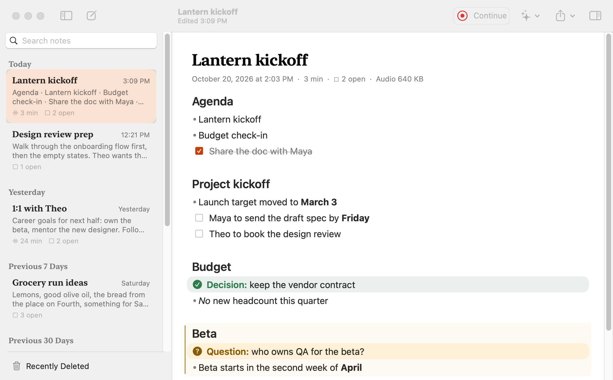
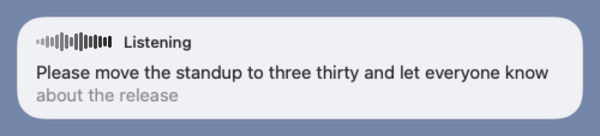
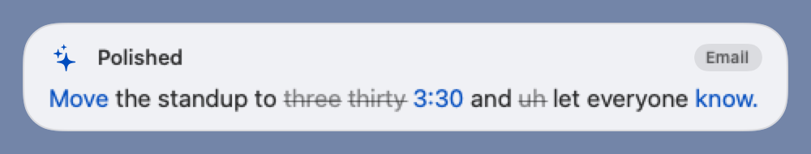
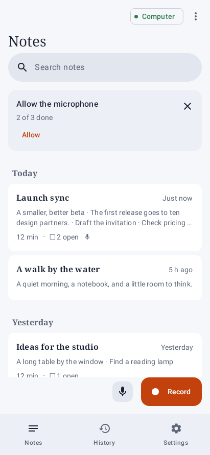
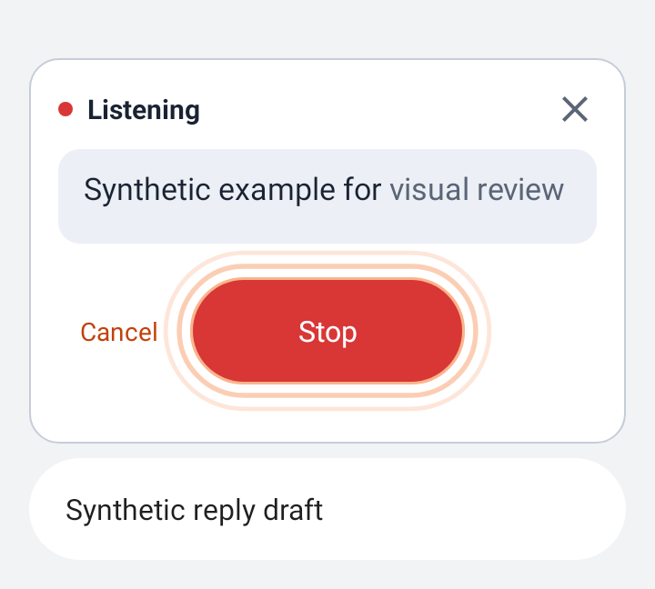
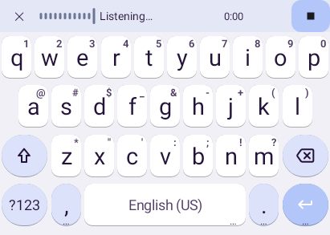
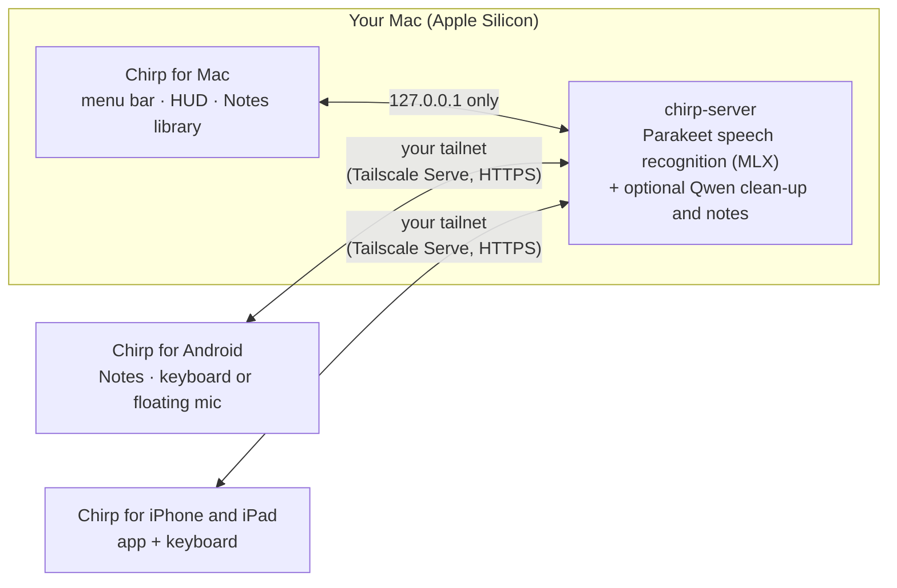

<p align="center">
  
</p>

<h1 align="center">Chirp</h1>

<p align="center"><strong>Private dictation and live notes. Your Mac does the listening.</strong></p>

<p align="center">
  <a href="https://github.com/araa47/chirp/actions/workflows/server.yml"></a>
  <a href="https://github.com/araa47/chirp/actions/workflows/android.yml"></a>
  <a href="https://github.com/araa47/chirp/actions/workflows/mac.yml"></a>
  <a href="https://github.com/araa47/chirp/actions/workflows/ios.yml"></a>
</p>

<p align="center"><a href="https://araa47.github.io/chirp/">Website</a> · <a href="#get-it-running">Get it running</a> · <a href="#privacy">Privacy</a> · <a href="docs/README.md">Docs</a></p>

<table>
  <tr>
    <td align="center" width="34%"><picture><source media="(prefers-color-scheme: dark)" srcset="docs/screenshots/mac/notes-library-dark.png"></picture><br><sub>Mac · Notes library</sub></td>
    <td align="center" width="22%"><picture><source media="(prefers-color-scheme: dark)" srcset="docs/screenshots/mac/hud-listening-dark.png"></picture><br><sub>Mac · dictate in any app</sub><br><br><picture><source media="(prefers-color-scheme: dark)" srcset="docs/screenshots/mac/hud-flow-3-diff-dark.png"></picture><br><sub>Optional clean-up</sub></td>
    <td align="center" width="22%"><picture><source media="(prefers-color-scheme: dark)" srcset="docs/screenshots/android/notes-library-cover-populated-dark.png"></picture><br><sub>Android · Notes</sub></td>
    <td align="center" width="22%"><picture><source media="(prefers-color-scheme: dark)" srcset="docs/screenshots/android/floating-listening-cover-dark.png"></picture><br><sub>Android · keep your keyboard</sub><br><br><picture><source media="(prefers-color-scheme: dark)" srcset="docs/screenshots/android/keyboard-listening-dark.png"></picture><br><sub>…or use Chirp Keyboard</sub></td>
  </tr>
</table>

Press a hotkey on your Mac, or the mic on your phone, and talk. Your words appear live in whatever text field you're using, and on the Mac the final text replaces them about a tenth of a second after you stop. Leave the mic open in a meeting and Chirp writes headings, to-dos and decisions as you talk, into a notes library you can search and replay. Everything runs on a Mac you own. Your phone reaches it over your own Tailscale network, and no other server is involved.

## What you get

**Dictate anywhere.** ⌃⌥Space (or any shortcut you record) in any Mac app; auto-stop when you pause, or hold to talk. Optional clean-up on your Mac removes fillers and fixes punctuation, with chat, email, code and notes styles chosen per app, and **Use raw** puts back exactly what you said. On Android, use **Chirp Keyboard** (a full HeliBoard keyboard with a mic key) or **keep Gboard or Samsung Keyboard** and dictate with a floating mic.

**Notes that remember.** ⌃⌥N on the Mac, or **Record** on Android, turns a long conversation into editable Markdown notes next to the transcript. Every note saves itself into a local library (no Save step), kept until you delete it, with search across notes and transcripts, Recently Deleted, Continue recording and Markdown export. Opt in to **Keep audio with notes** to replay what was said, segment by segment.

**Private by design.** No Chirp cloud, no account, no telemetry. Speech recognition and clean-up run on your Mac; phones pair by QR code over your tailnet.

| | |
|---|---|
| **Mac** · [mac/README.md](mac/README.md) | Menu-bar app with a floating HUD, the Notes library window (library sidebar, live-preview editor, transcript inspector with replay), System Settings-style Settings, a model manager and **Pair a Phone**. |
| **Android** · [android/README.md](android/README.md) | A Notes-first app (Notes · History · Settings), Chirp Keyboard or the floating mic, the Scratchpad for long text, opt-in encrypted dictation history, updates from your Mac over the tailnet. |
| **iPhone and iPad** · [ios/README.md](ios/README.md) | A SwiftUI app plus a dictation-first keyboard for iOS/iPadOS 18. Early: it passes its simulator tests but hasn't run on a device yet. |
| **Server** · [server/README.md](server/README.md) | Parakeet TDT v2 (English) or v3 (multilingual) on MLX, optional local Qwen clean-up and notes structuring, revocable per-device tokens and a `doctor` check. |

**Honest limits.** You need an Apple Silicon Mac that's on and reachable whenever you dictate. Phones connect only through Tailscale. Everything installs from source: there's no notarized Mac download, Play Store build or App Store build.

**How it compares.** Cloud dictation tools such as Wispr Flow and Typeless, and meeting-notes services such as Otter and Granola, process your audio on their own servers and generally charge a subscription. Apple Dictation and Gboard voice typing are free but tied to one platform, without Chirp's clean-up styles or notes. Superwhisper also runs locally, but it's closed source with paid tiers. Chirp's bet is that one Mac you already own can do all of this, privately, for every device you type on.

## How it works



The Mac runs one speech server that listens only on `127.0.0.1`. The phone apps record audio, stream it, and insert the text that comes back, reaching the server through `tailscale serve`, never the public internet. Measured on an Apple M5 Pro: first live words in **196–244 ms**, stop → final text in **96–107 ms**, recognition at **88–113× real time**, and clean-up in about **400 ms** warm ([docs/bench.md](docs/bench.md); observations on synthetic clips, not guarantees). Protocol and rules: [docs/architecture.md](docs/architecture.md).

## Get it running

You need an Apple Silicon Mac. For a phone you also need [Tailscale](https://tailscale.com) on both the Mac and the phone. The [website guides](https://araa47.github.io/chirp/guides/index.html) walk through each step.

### Build it with your coding agent

Open this repository in a coding agent such as Claude Code or Codex and paste:

> Install Chirp on this Mac from this checkout. Follow `README.md` → "Get it running", `mac/README.md` and `scripts/install-mac.sh`. Install any prerequisites that are missing (uv, Command Line Tools), run the installer, then tell me what to click in **Models on this Mac** and which permissions to grant. Then set up my Android phone: follow `android/README.md` → Install, using `android/scripts/setup-toolchain.sh`, a one-time signing key from `android/scripts/make-keystore.sh` and `./gradlew assembleRelease`, and install the **arm64** APK with `adb install -r` (or Taildrop). Finally, have me open Chirp → Settings → Devices → **Pair a Phone…** on the Mac and scan the QR code. Ask before changing Tailscale settings, never enable Funnel, and never paste pairing links or tokens into chat or logs.

For iPhone or iPad, point the agent at [ios/README.md](ios/README.md) → Install. That path needs full Xcode and your own Apple signing team.

### Or by hand

1. **Mac.** Install [uv](https://docs.astral.sh/uv/getting-started/installation/) and the Command Line Tools (`xcode-select --install`), then run:
   ```sh
   ./scripts/install-mac.sh          # server in ~/Library/Application Support/Chirp, Chirp.app in ~/Applications
   ```
   In **Models on this Mac**, download a speech model (optionally a clean-up model too) and click **Start Local Server**. Grant Microphone and Accessibility in Set Up Chirp, then press **⌃⌥Space** in any text field, or **⌃⌥N** to start a note. Re-running the installer updates the server and restarts Chirp's own LaunchAgent; it never touches a server you started yourself. Details, including `--server-only`: [mac/README.md](mac/README.md#install) and [server/README.md](server/README.md).
2. **Android.** Build the signed release APK and install the arm64 split:
   ```sh
   android/scripts/setup-toolchain.sh && source ~/.local/share/chirp-android/env.sh
   cd android && scripts/make-keystore.sh   # once; never replace a key that is already installed
   ./gradlew assembleRelease
   adb install -r app/build/outputs/apk/release/app-arm64-v8a-release.apk
   ```
   Onboarding asks how you'll dictate (Chirp Keyboard, or keep your own keyboard with the floating mic), then pairs by scanning the QR code from the Mac's **Pair a Phone…**. Full guide: [android/README.md](android/README.md).
3. **iPhone / iPad.** See [ios/README.md](ios/README.md) for requirements, same-team signing, Full Access and pairing.

## Privacy

**Your data stays yours.** Chirp has no servers of its own: your Mac is the server. Audio and text travel only between your own devices, over your own Tailscale network, and are never sent to us or any third party.

- **Dictation is transient.** Audio and text live in memory for one dictation, then they're gone. Logs hold timings and error codes, never what you said.
- **Notes stay on the device that recorded them**, kept until you delete them (or after 1 year, 90 or 30 days if you choose). They're never synced or indexed; on Android they're encrypted with a Keystore key, and on the Mac the files are readable only by your user account.
- **Audio with notes is opt-in** (off by default) and never leaves the device.
- **Dictation history is opt-in**, encrypted on the phone, kept for 24 hours, 7 days or 30 days.
- The speech server listens only on your Mac's loopback address, phones reach it only through your tailnet, and every phone pairs with its own revocable token. Clean-up runs on the same Mac; if you point it elsewhere, every client says where text goes.

Full details: [docs/privacy.md](docs/privacy.md).

## Repository and docs

```
server/   Speech server: Python 3.13, Starlette, parakeet-mlx (uv project) + tests and benchmarks
mac/      Chirp for Mac: Swift 6 / SwiftPM / AppKit + SwiftUI menu-bar app
android/  Chirp for Android: the app + Chirp Keyboard (HeliBoard-based IME)
ios/      Chirp for iPhone and iPad: SwiftUI app + dictation keyboard
site/     The website (stdlib-only generator; python3 site/build.py)
docs/     Architecture, benchmarks, privacy, testing, milestones (indexed in docs/README.md)
scripts/  Standalone Mac installer and the cross-component end-to-end check
```

[Architecture](docs/architecture.md) · [Benchmarks](docs/bench.md) · [Privacy](docs/privacy.md) · [Testing](docs/TESTING.md) · [Milestones](docs/milestones/README.md) · [All docs](docs/README.md) · Screenshots: [Mac](docs/screenshots/mac/) · [Android](docs/screenshots/android/)

## Licensing

- **Chirp's own code** (server, Mac app) has no license file yet; it is a personal-use project. No license is claimed for it here.
- **Chirp for Android** combines GPL-3.0 HeliBoard code with Chirp's Android client. This is a personal-use build; the corresponding source is available in this repository, and upstream copyright and license notices are kept intact. See the [pinned upstream record](android/keyboard/UPSTREAM.md) and [Android build instructions](android/README.md).
