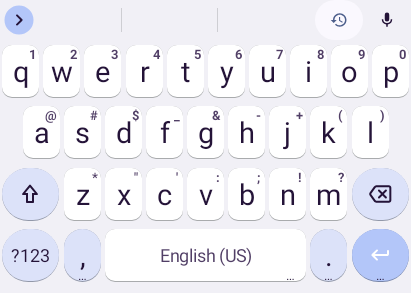
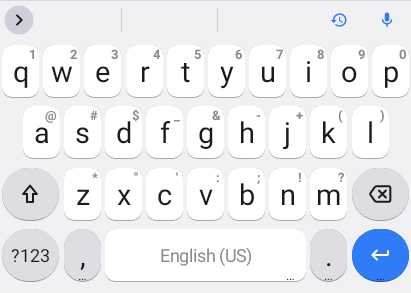
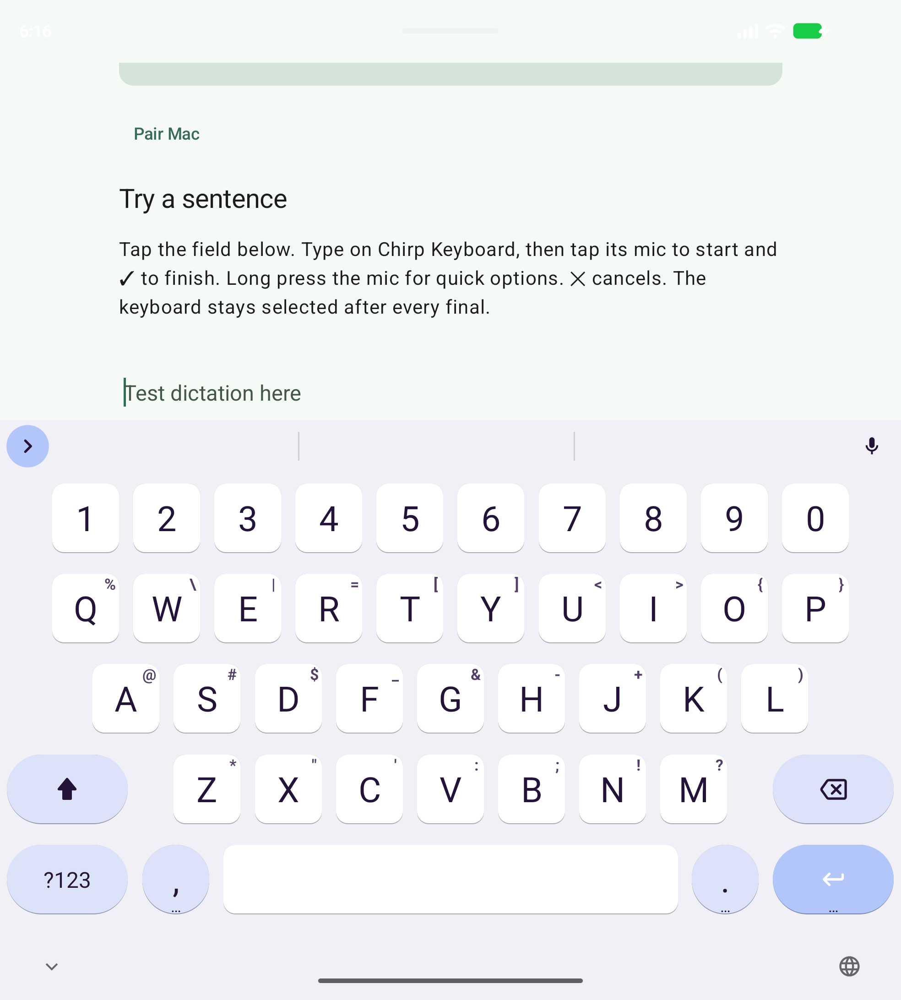
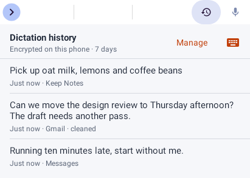
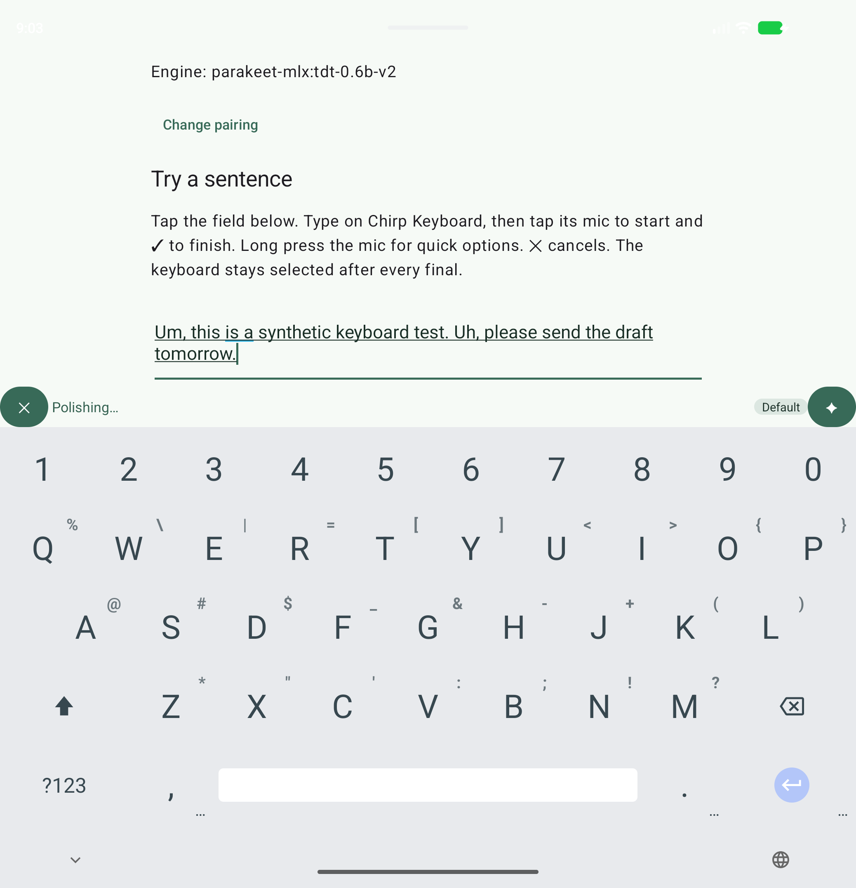
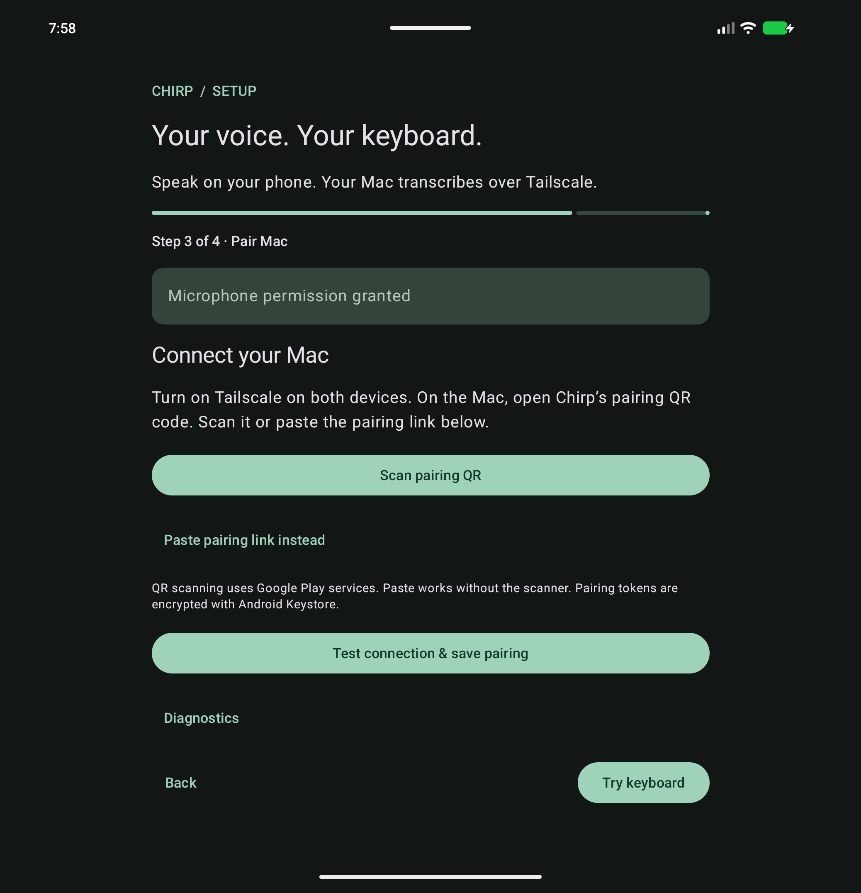
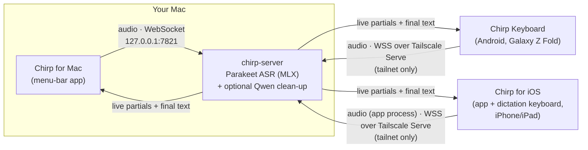

<p align="center">
  
</p>

<h1 align="center">Chirp</h1>

<p align="center"><strong>Local-first voice dictation for your Mac and your phone.</strong></p>

Chirp turns speech into text on machines you own. Speech recognition runs locally on your Mac (Parakeet on Apple Silicon) — press a hotkey in any app, talk, and the text lands in the focused field. An optional clean-up pass removes fillers and fixes punctuation; by default it runs as a model on the same Mac, so no text leaves the machine. The Android keyboard (a HeliBoard build for the Galaxy Z Fold) has a microphone key that streams your voice to that same Mac over Tailscale and inserts text in the focused field. Nothing — no audio, no transcripts — is retained by default; the single exception is iOS's transient encrypted app↔keyboard mailbox (see [Privacy & security](#privacy--security)).

## Highlights

- **System-wide Mac dictation.** ⌃⌥Space — or any shortcut you record, including ⌥ on its own — in any app. Auto-stop (press, talk, it stops when you pause) or hold to talk; Esc cancels. A floating HUD shows the live transcript while you speak; text is inserted directly (Accessibility), pasted, or copied as a fallback.
- **Recognition stays on your Mac.** The server binds to `127.0.0.1` only and runs your selected Parakeet TDT model via MLX (English v2 by default, with multilingual v3 available). Remote access, if you want it for the phone, is tailnet-only through Tailscale Serve.
- **Optional clean-up.** A local Qwen model can polish the final transcript — fillers, stutters, punctuation, casing — with styles for chat, email, code and notes, per-app styles, and editable prompts. Off by default; every clean-up keeps the raw text one keystroke away ("Use raw" for 5 s).
- **Android keyboard.** A full HeliBoard keyboard plus a mic key: live text appears underlined in the field, and the final replaces it. Gboard-like default look with a Samsung-like option, a Fold-tuned inner-screen layout, English QWERTY with autocorrect, clipboard history and emoji, and an opt-in on-device encrypted dictation history. Swipe typing works with a library you supply — none is bundled.
- **iPhone and iPad dictation (implemented, pending Xcode validation).** A native SwiftUI app plus a dictation-first custom keyboard for iOS/iPadOS 18: pair by QR to the same Mac server, dictate from compatible text fields with verified safe replacement (secure fields and hosts that disallow custom keyboards use Apple's keyboard; unreliable editor contexts stop auto-replacement safely), companion controls (Action Button, Control Center, Shortcuts, Live Activity) and opt-in on-device encrypted history. Not installable yet — no iOS build/simulator/device check has run; see [ios/README.md](ios/README.md).
- **Private by default.** No recordings, transcripts or logs of what you said. Debug retention is opt-in, local-only and loudly visible in both clients. Pairing uses a secret bearer token shown as a local QR code.

## Screenshots

**Mac** — menu bar, dictation HUD and Settings ([all light + dark captures](docs/screenshots/mac/)):

| Menu bar | HUD while speaking | Clean-up in Settings |
| :---: | :---: | :---: |
| <a href="docs/screenshots/mac/menu-ready-light.png"></a> | <a href="docs/screenshots/mac/hud-listening-light.png"></a> | <a href="docs/screenshots/mac/settings-cleanup-custom-light.png"></a> |

**Android** — keyboard looks, dictation history, Fold layout and pairing ([all captures](docs/screenshots/android/)):

| Gboard-like look | Samsung-like look | Fold inner layout |
| :---: | :---: | :---: |
| <a href="docs/screenshots/android/keyboard-look-gboard-idle-light.png"></a> | <a href="docs/screenshots/android/keyboard-look-samsung-idle-light.png"></a> | <a href="docs/screenshots/android/fold-layout-after-gboard-inner-portrait-light.png"></a> |
| Dictation history | Polishing on the strip | Pair by QR |
| <a href="docs/screenshots/android/keyboard-history-light.png"></a> | <a href="docs/screenshots/android/emulator-cleanup-polishing-light.png"></a> | <a href="docs/screenshots/android/release-pairing-light.png"></a> |

## How it works

One speech server runs on the Mac; both clients are thin. All recognition and clean-up happen on the Mac. The phone only captures audio, streams it, and inserts text.



## Quick start

### 1. Standalone Mac install

From a Chirp checkout on an Apple Silicon Mac, install [uv](https://docs.astral.sh/uv/getting-started/installation/) and Apple Command Line Tools (`xcode-select --install`), then run:

```sh
./scripts/install-mac.sh
```

This installs the server's locked Python environment under `~/Library/Application Support/Chirp/server`, builds and signs `Chirp.app`, installs it in `~/Applications`, and opens its model picker. No dotfiles, Nix, Koi, or Tailscale installation is required. macOS may ask you to approve the local signing identity. This is a source installer; a notarized downloadable Mac release is not provided yet.

### 2. Choose your models

In **Models on this Mac** (also **Settings → Server → Manage Local Models…**):

1. Choose a speech model and click **Download**. Parakeet v2 is the English default; v3 offers multilingual recognition.
2. Optionally choose and download a local correction model. **Use Model** checks that it loads, then saves your choice; choosing a correction model configures managed local correction.
3. Click **Start Local Server**, or **Apply & Restart Server** after changing a selection. Downloading a model alone never switches the running server.
4. Grant Microphone and Accessibility in Set Up Chirp, then press **⌃⌥Space** in a text field and speak.

**Check for Updates** looks up newer revisions of known models without downloading weights or changing your selection. **Add Model** accepts a public Hugging Face `owner/model` repository and checks for a compatible Parakeet TDT or quantized MLX language model. Downloads show size, percentage, Pause/Resume and Retry. Newly added models are checked for loader compatibility, not transcription/correction quality; [benchmarked defaults and tradeoffs](docs/bench.md) remain unchanged.

For server-only installation use `./scripts/install-mac.sh --server-only`. Developer setup and CLI instructions: [server/README.md](server/README.md). App permissions and behavior: [mac/README.md](mac/README.md). Repository access and licensing are separate from installation; see [Licensing](#licensing).

### 3. Chirp Keyboard (Android)

A HeliBoard-based keyboard for the Galaxy Z Fold that streams to your Mac over Tailscale. Build and install the signed release APK:

```sh
source ~/.local/share/chirp-android/env.sh
cd android
./gradlew assembleRelease
adb install -r app/build/outputs/apk/release/app-release.apk
```

On the phone: enable Chirp Keyboard, grant the microphone, then pair by scanning the QR that `uv run chirp-server pair` prints on the Mac. Full setup, build and validation notes: [android/README.md](android/README.md).

### 4. Chirp for iPhone and iPad (not installable yet)

The iOS/iPadOS 18 app, dictation keyboard and companion controls are implemented on the iOS integration branch, but no installable build exists: the build machine has only the Command Line Tools, and no iOS compile, simulator or device check has run. The server must also be restarted from this branch's source so it accepts `ios` clients. Once full Xcode is available, the operator install steps (same-Team signing, Full Access, pairing, per-device Run) are in [ios/README.md](ios/README.md); the implementation-evidence record and pending gates are in [docs/review/ios-foundation.md](docs/review/ios-foundation.md) and [docs/review/ios-keyboard.md](docs/review/ios-keyboard.md).

## Privacy & security

- **Nothing is retained by default.** Audio and transcripts live in memory for the length of an utterance, then they are gone. One disk exception, iOS only: the app↔keyboard mailbox holds AES-GCM-encrypted transient text until consumed or expired, deleted on next access (no purge daemon); opt-in dictation history is encrypted too. Logs carry only timings, byte counts and error codes. There is no telemetry.
- **Debug retention is opt-in, local and loud.** With `--debug-retain`, WAV + transcript files are written under `~/Library/Application Support/Chirp/debug/`, expire after three days, and both clients show a persistent red warning.
- **Tailnet-only exposure.** The server binds to loopback. Publishing it for the phone uses `tailscale serve` (your private tailnet, TLS from the tailnet cert) — never the public internet.
- **Bearer pairing.** Clients authenticate with a token generated on the Mac (`~/.config/chirp/token`, mode 0600). The pairing QR/URI is printed locally only; treat it as a secret. Audio is rejected before authentication even begins.
- **Clean-up stays on your Mac** in `managed` mode (a local MLX model, forced offline). If you deliberately point correction at an external OpenAI-compatible endpoint, clients label the feature "sends text to \<host\>". Audio never leaves the Mac; only the final text can, and only then.

## Repository layout

```
server/   Speech server: Python 3.13, Starlette, parakeet-mlx (uv project) + tests and benchmarks
mac/      Chirp for Mac: Swift 6 / SwiftPM / AppKit menu-bar app
android/  Chirp Keyboard: HeliBoard-based Android IME + setup app (see android/README.md)
ios/      Chirp for iPhone and iPad: SwiftUI app + dictation keyboard (see ios/README.md)
docs/     Architecture, benchmarks, testing, milestones — indexed in docs/README.md
scripts/  Cross-component end-to-end check (scripts/e2e-local.sh)
```

## Documentation

- [docs/README.md](docs/README.md) — index of everything in `docs/`
- [Architecture](docs/architecture.md) — components, wire protocol, privacy rules, permissions, measurement plan
- [Benchmarks](docs/bench.md) — measured engine, finalization and clean-up-model results
- [Testing](docs/TESTING.md) — automated checks, operator steps, privacy checks
- [Milestones](docs/milestones/README.md) — M1 server, M2 macOS client, M3 Android IME, M4 integration, M5 iOS

Component docs: [server/README.md](server/README.md) · [mac/README.md](mac/README.md) · [android/README.md](android/README.md) · [ios/README.md](ios/README.md)

## Licensing

- **Chirp's own code** (server, Mac app) has no license file yet; it is a personal-use project. No license is claimed for it here.
- **Chirp Keyboard for Android** combines GPL-3.0 HeliBoard code with Chirp's Android client. This is a personal-use build; the corresponding source is available in this repository, and upstream copyright and license notices are kept intact. See the [pinned upstream record](android/keyboard/UPSTREAM.md) and [Android build instructions](android/README.md).
