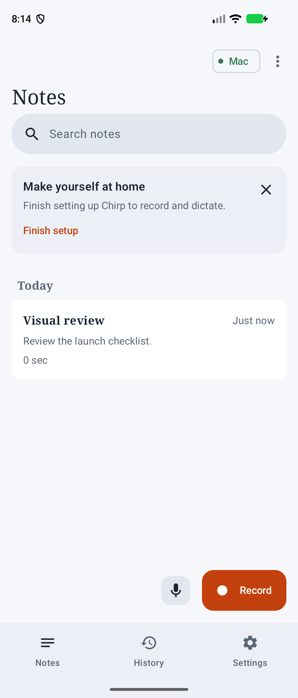
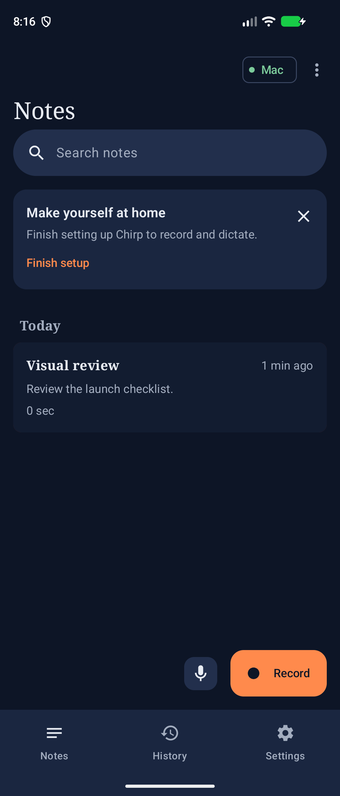
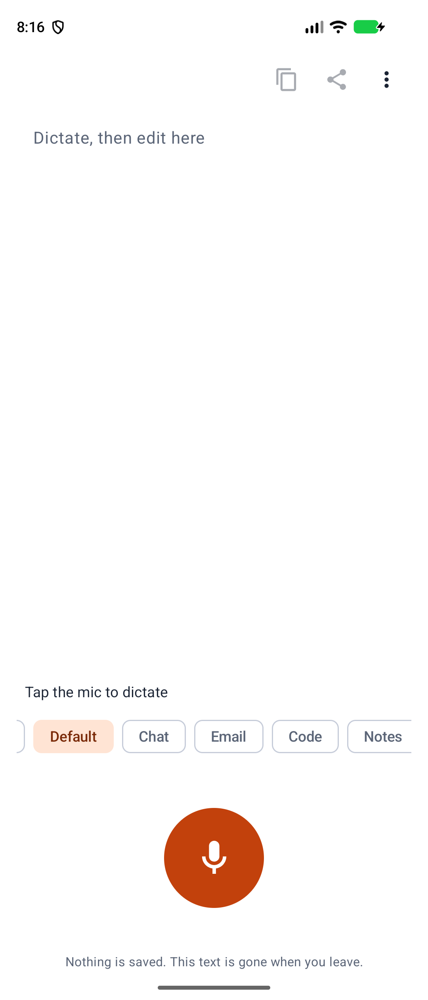
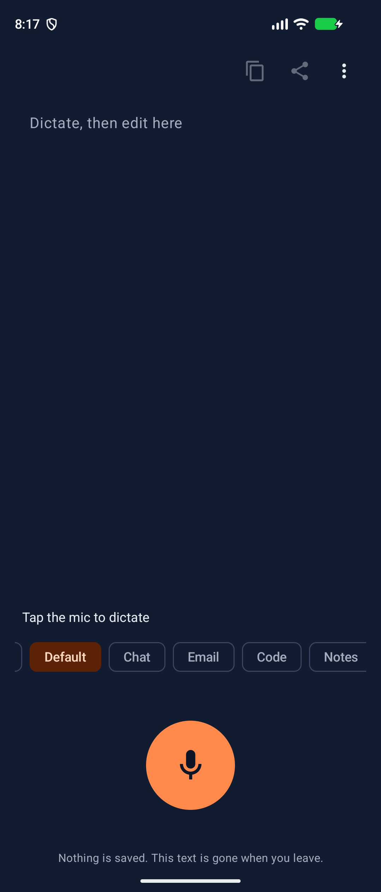
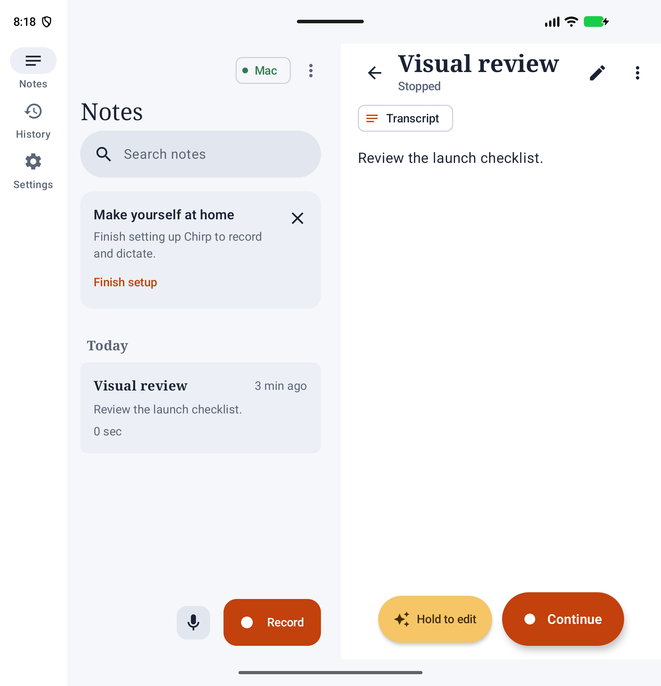
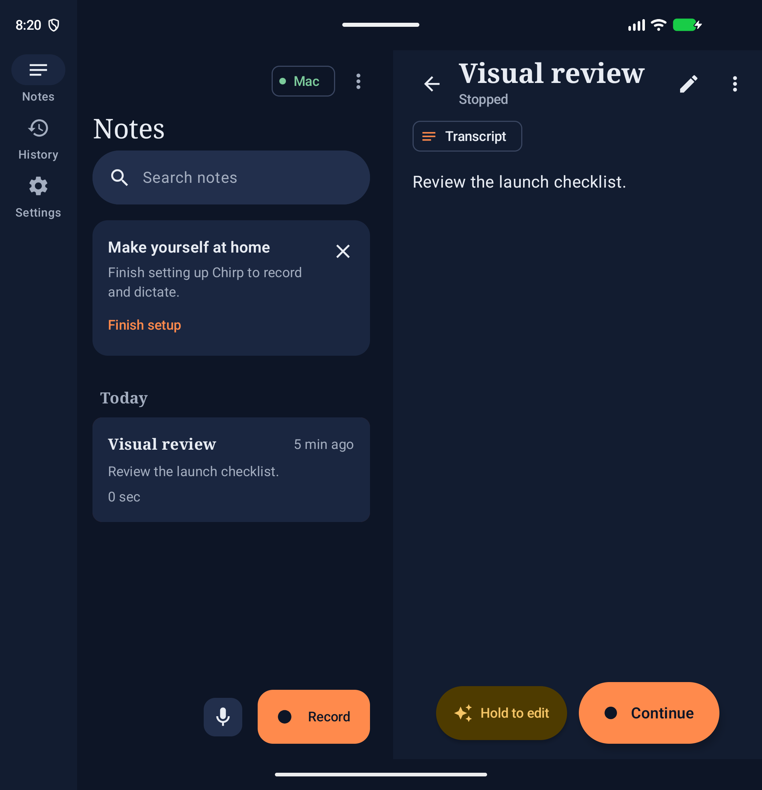

# Android final verification — 25 October 2026

Android source baseline: `6459ef0` on `ux/modern`. The subsequent target-branch change is Mac-only. All runs used disposable, read-only fold emulators, one host-wide lease, a throwaway TLS server, synthetic speech and local debug signing. The reserved orphan emulator was untouched.

The full `android/scripts/e2e-all.sh` run passed the nine original phases and failed the added visual and keep-keyboard phases. After correcting their navigation and permission actions, both passed in a focused run. Bubble then passed again with the hardened optional-action probe. Results below are the final aggregate of those runs, not a claim that the earlier full invocation was all green.

| Gate / flow | Final result | Evidence / limits |
| --- | --- | --- |
| Lint | PASS | Warnings are errors. |
| Unit tests | PASS | 1,087 tests: 1,085 passed, two opt-in LiveServer tests skipped; real-server checks ran separately below. |
| Debug + release builds | PASS | Both ABIs, local debug keystore only; native libraries pass 16 KB alignment. |
| Dictation / keyboard hold (#175) | PASS | Real IME tap and press/hold/release, composing partials and cleaned finals, light/dark. |
| Cleanup | PASS | Managed correction, styles, Polishing, Use raw, frame metrics, light/dark. |
| Notes library + kept audio | PASS | Real rolling speech, voice edit, screen-off, pause/resume/stop, search, rename, delete/Undo, trash/restore, Continue, AAC encode and MediaPlayer natural completion. |
| History full sweep | PASS | Opt-in, encrypted storage, cleaned/raw reinsertion, cover/inner light/dark, full-screen search, opt-out deletion. |
| Stop matrix | PASS | Immediate, listening, partial, polishing, double-stop, hide, focus and unbind. |
| Device functionality | PASS | Real TalkBack actions, primary control bounds at 200% font, actual folded/open device states during recording. |
| Floating mic (#173) | PASS | Tap/hold, real insertion, copy fallback, drag/snap, keyboard retention, errors, custom accessibility actions; final hardened run also inserted into WebView. Raw replacement fixture gap: [#183](https://github.com/araa47/chirp/issues/183). |
| Quick Dictate / Share (#179) | PASS | Dictate tile, sensitive clipboard, Speak result/cancel/error, Share-to-Notes, Notes tile, widget provider registration. Actual widget placement: [#184](https://github.com/araa47/chirp/issues/184). |
| Keep-keyboard onboarding (#170) | PASS | Fresh choice, disclosure, system Accessibility, restricted-help/app-info route, enable/return, mic permission, pairing, Gboard retained, mode switches, picker, bubble visibility with each IME. |
| Release smoke + TalkBack | PASS | Release install, scanner open/back, typing/autocorrect/clipboard/emoji, fold geometry, options, diagnostics, Quick Dictate and Share accessible actions. |
| Main-screen visual walkthrough | PASS with open defects | 88 real-emulator captures inspected: 22 screens/states × cover/inner × light/dark. Includes library, detail/transcript, History, all Settings pages, Scratchpad, Quick Dictate, Share and all six onboarding surfaces. |
| Inner Settings system-bar insets | OPEN — [#181](https://github.com/araa47/chirp/issues/181) | Category column and lower content can scroll behind system bars. |
| 200% rail label layout | OPEN — [#182](https://github.com/araa47/chirp/issues/182) | Fixed rail crowds/clips enlarged labels despite usable primary Notes controls. |
| Bubble raw replacement determinism | OPEN — [#183](https://github.com/araa47/chirp/issues/183) | Missing/expired Use raw must not be inferred to mean unchanged correction. Killed probes now fail. |
| Real launcher widget placement | OPEN — [#184](https://github.com/araa47/chirp/issues/184) | Provider registration passes; placement and widget taps need acceptance. |

The visual review checked clipping, overlap, contrast, tonal surfaces, title truncation and action placement. Light-mode system indicators were white on light surfaces: fixed here with theme-aware system-bar icon settings and a regression test. The dark palette and main cover/inner layouts are consistent; the two remaining layout defects are linked above.

The keep-keyboard run also exposed a real `SecurityException` when a system image resolved but restricted the Accessibility details activity. The app now falls back to general Accessibility settings, with tests for both restricted and missing activities.

The harness now uses the dedicated options button after push-to-talk replaced the old long press, waits for real native draw buffers in onboarding/Settings render tests, queries transient states without repeatedly traversing virtual keyboard trees, exposes IME window types, and uses accessibility clicks for permission/Finish actions. Synthetic setup happens before enabling Accessibility so a force-stop cannot silently unbind it. Optional bubble actions explicitly report an absent target and propagate adb failures. No retries were added.

The [key screenshots](screenshots/android/final-verification/) contain only reviewed synthetic UI. Private run logs, XML, certificates, credentials and audio are excluded. Physical-device restrictions, OEM behavior and real scanner provisioning retain the acceptance boundaries in [TESTING.md](TESTING.md).

| Cover, light | Cover, dark |
| --- | --- |
|  |  |
|  |  |

| Inner, light | Inner, dark |
| --- | --- |
|  |  |

Additional evidence: [keyboard hold](screenshots/android/final-verification/keyboard-hold-light.png), [bubble](screenshots/android/final-verification/bubble-cover-dark.png), [History](screenshots/android/final-verification/history-panel-inner-dark.png), [kept audio playing](screenshots/android/final-verification/kept-audio-playing.png), [onboarding choice](screenshots/android/final-verification/cover-light-onboarding-choice.png), [floating-mic guide](screenshots/android/final-verification/inner-dark-onboarding-floating.png), [Share](screenshots/android/final-verification/cover-dark-share.png), [Settings dark](screenshots/android/final-verification/inner-dark-settings-home.png), [inset defect](screenshots/android/final-verification/inner-light-settings-about.png), [large-font rail defect](screenshots/android/final-verification/font200-rail.png).
