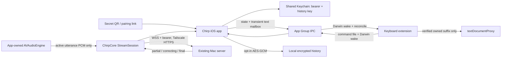

# M5 — Chirp for iPhone and iPad

Status: source integrated and CLT checks passed, 2026-10-18; iOS build and
simulator/device acceptance blocked on operator Xcode/signing setup. Final
evidence: [iOS integration](../review/ios-integration.md). Integration branch `chirp/ios`, based on
`main` at `e4d9e6d`. The parent orchestrator reviews and merges; no worker pushes,
opens a PR, merges main, or installs on physical devices.

## Product and acceptance

Build a native SwiftUI app and dictation-first keyboard for iOS/iPadOS 18+.
Recognition and optional clean-up run on the existing Mac server. iOS captures
16 kHz mono PCM16LE and reuses `ChirpCore` protocol, `StreamSession`, conversion,
profiles and timing types. Existing Mac tests and release build must remain green.

The app provides camera QR pairing and paste-link fallback, connection check,
live dictation, clean-up styles with editable prompts and destination disclosure,
Use raw, explicit copy/share, opt-in encrypted on-device history, settings and
content-free diagnostics. History starts off; clean-up starts off until health
and the user's choice permit it. No unsolicited clipboard writes from normal app
dictation. Companion dictation explicitly targets the clipboard.

The keyboard provides mic/stop, cancel, space, delete, return, Use raw, style and
globe. It requires Full Access for shared state. A session starts in the app;
after the user returns to their editor, keyboard commands control the app-owned
microphone. Session choices: 5 minutes (default), 15 minutes, 1 hour, never.
Every surface exposes End session. Never means until manually ended, interrupted,
terminated, or revoked; it cannot promise indefinite background execution.

The app fits iPhone, iPad portrait/landscape, narrow multitasking and Stage
Manager. Use adaptive navigation, accessible Dynamic Type, large touch targets,
hardware keyboard shortcuts in the app, and a wider keyboard layout on iPad.
Secure fields and hosts that disallow custom keyboards use Apple's keyboard.

## Platform decisions and explicit limits

Apple's keyboard sandbox has no microphone access, including Full Access:
[custom keyboards](https://developer.apple.com/library/archive/documentation/General/Conceptual/ExtensibilityPG/CustomKeyboard.html).
Audio capture is exclusively in the containing app. Background audio requires
the audio background mode and an active recording session. During an armed
session the app keeps its capture engine running, discards idle PCM immediately,
and sends audio only during an explicit utterance. The system microphone
indicator therefore remains on throughout the armed session. UI must explain
this honestly; do not suggest that the microphone is off between utterances.
Interruption, route failure, expiry, end, permission loss and transport failure
must stop or safely reconcile capture and visible state. No silent audio playback
or artificial background task is used to keep the process alive.

First keyboard mic tap attempts `chirp://session/start` through the extension
context, with a visible fallback telling the user to open Chirp manually if iOS
refuses. Keyboard extension URL launching is not a guaranteed supported handoff;
do not use private selectors or the UIApplication responder-chain workaround.
Document this personal-install limitation and App Store review risk; no automatic
return to an arbitrary previous app is promised. The user returns using the
system Back to app affordance or app switcher. This is an on-device acceptance
gate, not something simulator UI can establish.

Companion actions use App Intents and `AudioRecordingIntent`, with a Live Activity
active throughout recording as [Apple requires](https://developer.apple.com/documentation/appintents/audiorecordingintent).
Provide Start/Stop/Cancel/End actions, App Shortcuts, an iOS 18 Control Center
control, and a lock-screen/Dynamic Island activity. Foreground permission/setup
remains mandatory; cold background recording may be restricted. Fall back to
opening the app and give a useful setup message. Never put transcripts, hostnames,
pairing links or tokens on the lock screen. Activity availability is gated at
runtime; OS behavior and device support are acceptance items.

## Targets, layout and signing

Keep the Mac Swift package at `mac/`. Make its `ChirpCore` library build for iOS
by isolating Carbon/AppKit/macOS capture/insertion code with platform guards or
target selection; don't duplicate protocol implementations. Add `ios/Shared/`, a
Swift package exposing `ChirpIOSCore`, depending on local `../../../mac` as
appropriate to its location. Foundation/CryptoKit state and storage logic has
macOS-runnable unit tests; UIKit/Keychain/App Group adapters are conditional.

| Target | Bundle ID | Responsibility |
|---|---|---|
| ChirpIOS | `dev.chirp.ios` | SwiftUI app, camera, audio owner, pairing, history |
| ChirpKeyboard | `dev.chirp.ios.keyboard` | UIKit keyboard and safe text proxy insertion |
| ChirpWidgets | `dev.chirp.ios.widgets` | Live Activity and iOS 18 control |
| ChirpIOSTests / ChirpIOSUITests | test IDs | simulator unit/integration/UI tests |

Use one configurable App Group `group.dev.chirp.ios` and one keychain group
`$(AppIdentifierPrefix)dev.chirp.ios.shared`, consistently across targets.
Token and AES-GCM history key belong only in Keychain, accessible after first
unlock, this-device-only, never synchronized. Shared defaults contain preferences
and nonsecret connection metadata only. Build settings allow changing the prefix,
group and developer team without editing sources. App has microphone/camera usage
strings, `UIBackgroundModes=audio`, `NSSupportsLiveActivities`, URL schemes and
iPhone+iPad families; keyboard declares `com.apple.keyboard-service`, English,
`RequestsOpenAccess=true`, and no microphone entitlement. No arbitrary ATS loads.
History and IPC directories are backup-excluded and use file protection.

Use a reproducible checked-in Xcode project, or a deterministic generator plus
its source and explicit prerequisites. All extensions must be embedded, signed
by the same team, and inherit matching group IDs. Do not invent Team IDs. Operator
must handle Apple ID login, provisioning and device trust. Free Personal Team
profiles expire after seven days and capabilities must be checked in the actual
profile; do not promise that App Groups are available on every free account.
TestFlight/ad-hoc distribution requires appropriate paid membership/profiles.

## Data flow and shared-state contract

Shared IPC cannot write plaintext transcripts even temporarily. Store commands
and state as small atomic bounded Codable files; text payloads are AES-GCM sealed
with a shared this-device-only Keychain key. There is no audio on disk. Delete
mailbox contents on consumption/expiry/session end, and reject stale generations,
duplicate IDs and foreign utterances. Never use UserDefaults for transcript text.
Darwin notifications carry no payload; file state is authoritative and read again
on foreground/appearance. Use file coordination or locking for read-modify-write,
separate app/keyboard writer ownership where feasible, and a short heartbeat/lease
so a killed/suspended app never looks like a healthy armed session.

Agree concrete APIs between track owners through `koi msg` before integration.
The shared package owns pairing validation/store, preferences, history store,
bridge commands/state/result and Darwin signal adapter. The app owns a single
`@MainActor` dictation/session coordinator, reused by App Intents. Keyboard is a
client only and does not start network/audio work. Widget code shares only the
activity attributes and intent declarations it needs; app-only implementations
must execute in the app process.

Pairing validation accepts exactly `chirp://pair?url=…&token=…`, rejects duplicate
or unknown secret-bearing parameters and malformed/empty credentials. Production
base URLs require HTTPS, no userinfo/query/fragment, and a `.ts.net` tailnet host
(document any intentional expansion); preserve `/chirp` when creating endpoints.
Verify authenticated health before saving. Don't render or log links or tokens.
Use an ephemeral URLSession, disallow credential-bearing cross-origin redirects,
and never disable TLS validation. Synthetic tests use injected transports, not
production credentials or a relaxed shipping ATS configuration.

Each utterance has a session generation and UUID. App waits for ready before
streaming, bounds pre-ready audio and lifetime, consumes partial/correcting/final,
and flushes conversion before stop. Cap utterances at 120 seconds, final wait and
polishing at bounded deadlines; cancel sends nothing to the editor. On cleanup
failure after `correcting`, keep raw in memory for fallback. Filter all errors to
local codes; never display server error text in diagnostics. Debug retention is
a persistent red warning in app/keyboard/activity state. External clean-up needs
a known disclosed destination and explicit consent; changes suspend consent.

iOS textDocumentProxy has no Android-style composing region. Maintain an owned
suffix and context/cursor evidence before deleting/replacing partials or applying
Use raw (5 seconds). Invalidate on cursor edits, selection, host/field changes,
hide/reload, unavailable/truncated context, or any uncertain ownership. Never
blindly delete by previous transcript length. On uncertainty leave existing
content intact and offer manual recovery in the app. Unit-test non-BMP graphemes,
context truncation, stale final/cancel, repeated callbacks and user edits.

History: opt-in only, AES-GCM, at most 200 finals, retention 24 hours/7 days/30
days (default 7), search/copy/raw/delete/clear, disabling deletes data and key.
Never record cancel or empty results. Keyboard cannot reliably infer every host's
private mode: expose a session privacy control and document that limitation;
do not collect surrounding text. No background history sync or telemetry.
Diagnostics export allowlisted version/OS/phase/error code/duration/count fields,
never exception messages, URLs, tokens, prompts, audio or transcripts.

## Worker tracks and integration

1. **ios-foundation (Codex)** — ChirpCore portability, `ios/Shared` package,
   pairing, Keychain, encrypted history and encrypted bridge, pure tests. Own
   `mac/**` and `ios/Shared/**`. Immediately send public API details to siblings.
2. **ios-app (Codex)** — SwiftUI app, capture/session owner, scanner/settings/
   history/diagnostics/iPad behavior, project/entitlements/test scripts, simulator
   tests. Own `ios/App/**`, `ios/Config/**`, project/build/test files and app tests.
3. **ios-keyboard (Codex)** — keyboard, safe insertion tests, intents, activity
   and Control Center sources. Own `ios/Keyboard/**`, `ios/Intents/**`,
   `ios/Widgets/**` and their tests. Coordinate coordinator API with app worker.
4. **docs/validation (Z.ai after initial tracks)** — operating/install guide,
   privacy and limitations, docs index/README links, review source against guide.

Every brief: base `chirp/ios`, commit locally, no push/PR, no device install,
simulator only; use `koi run` for long jobs and report real evidence and blockers.
Orchestrator reads each diff, resolves contract issues through the owner, merges
only into `chirp/ios`, and runs final checks. Parent gets spec/blocker/merge reports.

## Validation and operator handoff

Available now (CLT): `mac/scripts/test.sh`, `cd mac && swift build -c release`,
shared package unit tests with the CLT Testing plugin path, Swift source parsing,
plist/entitlement/project structural validation. Record actual pass counts and
commands. Do not claim an iOS build based on syntax checks alone.

After Xcode: generate/open project, unsigned generic iOS Simulator build; run
unit/UI schemes on a disposable iPhone and iPad simulator. Use synthetic/injected
audio/transport, no microphone prompts or production server. Cover QR parser,
credential isolation, ready/partial/correcting/final/word timings, all teardown
paths, consent transitions, IPC expiry/replay, encrypted-at-rest/no-default-write,
history tamper/retention/disable races and text-ownership safeguards. UI: pairing
fallback, state/status, styles/Use raw/copy/share/history, light/dark, Dynamic Type,
VoiceOver labels, narrow iPad, landscape, hardware keyboard, permissions denied.
No simulator run proves background audio survival or keyboard handoff on hardware.

Manual operator checklist for **both** iPhone and iPad:

- Install full Xcode + matching iOS SDK/runtime, accept its license/first launch;
  sign in personally, choose team and unique bundle/group identifiers.
- Connect/trust device, enable Developer Mode, select it in Xcode and Run app;
  do not uninstall to update pairing. Check all embedded extension profiles.
- Connect Tailscale, generate QR locally, scan and verify health, deny/retry camera
  and microphone, verify no token in diagnostics and no HTTP/public-host pairing.
- Add keyboard in Settings → General → Keyboard → Keyboards, allow Full Access;
  test denial fallback, globe, secure fields, Notes/Messages and a third-party app.
- Test first-tap handoff/manual fallback, user return, subsequent start/stop,
  partial/final/Use raw and edits/cursor/field-switch safety. Check no duplicate
  insertion and no deletion of unrelated text.
- Observe microphone indicator throughout armed session; no audio reaches server
  between utterances. Test 5/15/60/never, End session, lock/unlock, call/Siri/route
  interruptions, force quit/relaunch, Tailscale loss and server timeout.
- Test cleanup local/external disclosure, changed destination, debug-retain red
  warning, cancel while polishing, raw fallback, empty results and 120 s limit.
- Test Action Button (supported hardware), Shortcuts, Control Center and Live
  Activity from unlocked/locked/cold states; clipboard result only for that path.
- Test history opt-in, ciphertext, retention/cap/raw/delete/disable, no backup and
  privacy mode; inspect diagnostics with synthetic sentinel text.
- Test iPad split view/Stage Manager widths/rotation and hardware keyboard access;
  VoiceOver, large text, reduce motion, dark/light, battery/thermal cost of session.

Current blocker: full Xcode is absent (`xcode-select` points at CLT). Operator was
asked once via Koi for install method/permission, membership/Team ID and device
models/versions. All runtime/build/device claims stay pending until evidenced.
