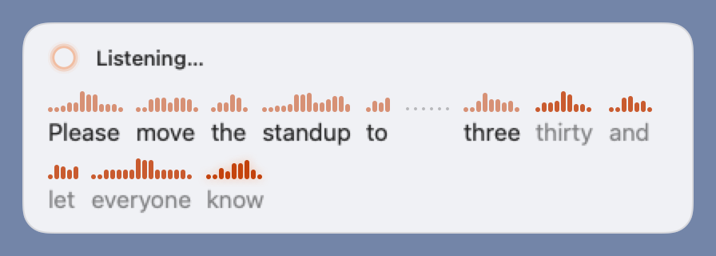

# Word waveform overlay: design notes

Operator request: *"next to / above the words, have the waveforms, so we can see each word map into
something in the waveform. Should probably be an optional mode, but make it cool."*

## What ships

Settings → Dictation → **Word waveform overlay** (off by default). When on, the Mac asks the server for
`word_timings` and the HUD draws the live transcript word by word, each word with the bars of its own
audio directly above it. The committed snapshots are
`docs/screenshots/mac/hud-wordwave-{listening,long,polishing}-{light,dark}.png`.

- **Mapping is spatial.** A word's bars sit over the word, so the eye never has to travel between a
  strip and a sentence. Each ribbon is linear in time inside the word; the layout is text-ordered,
  so it wraps and reads like the transcript always did.
- **Silence is visible.** A pause of 300 ms or more widens the gap between the two words
  (40 pt per second, capped at 30 pt) and draws a faint dotted rest in the ribbon row.
- **Alive while recognised, settled when stable.** Unstable words have accent-tinted bars and
  lighter text; the current word breathes (a gentle opacity/height pulse at 1.1 s, with a soft glow)
  and new words spring in from the baseline. When the server marks a word stable its bars ease to
  the solid colour. A revised word (same position, new text) crossfades in place, tinted for a beat.
- **Long utterances** keep only the newest words (200 characters, like the plain HUD) behind an
  ellipsis cell, so the word being spoken is always on screen; the panel grows to four lines at most
  in practice.
- **Polishing.** Cleaned text cannot be mapped onto the audio word for word. The `correcting`
  message carries the raw decode's words, so the raw words stay with their audio, all settled, under
  the shimmer sweep; when the cleaned text lands the ribbon fades out and the usual diff/plain text
  shows. "Use raw" and the uncorrected final keep their behaviour (an uncorrected final settles every
  word with the final's own timings).
- **Reduce Motion** keeps the layout and drops the pulse, the springs and the sweep. **Increase
  Contrast** raises the ribbon and gap opacities. **VoiceOver** reads the transcript as one
  frequently-updating element, exactly as before; the ribbon is decorative.
- **Off**, or with a server/engine without timings (an old server, the ONNX fallback): the HUD is
  byte-for-byte the old one (the plain text path is untouched).

## Variants considered

Three layouts were prototyped offscreen with the same demo utterance and levels.

| Variant | Snapshot | Verdict |
|---|---|---|
| **A. Anchored ribbon** (shipped): the transcript in a wrapping flow, each word's bars above it, pauses as widened dotted gaps | [variant-a-anchored-first-draft.png](word-waveform/variant-a-anchored-first-draft.png) (first draft, before the stable/unstable text colours were fixed) | Every word maps at a glance, wraps like text, no labels to truncate; the only trade-off is that time is not linear *between* words, which the pause gaps make up for. |
| B. Time-linear strip with labels: one strip of the whole utterance, word spans shaded and labelled beneath, transcript under it | [variant-b-timeline-strip.png](word-waveform/variant-b-timeline-strip.png) | Honest about time, but the labels truncate ("mo…", "stand…") at speech pace, the strip must compress or scroll for anything longer than a few seconds, and the sentence below is disconnected from the strip. |
| C. Strip plus connector: the strip above the plain transcript, the current word's span glowing with a connector down to the word | [variant-c-connector.png](word-waveform/variant-c-connector.png) | Only the current word is really mapped; the connector needs per-word text geometry, which breaks as soon as the text wraps, and it reads as a diagram rather than a HUD. |

A was chosen: it satisfies "see each word map into something in the waveform" for *all* words at
once, needs no scrolling model, and degrades gracefully (fewer bars for short words, an ellipsis for
long dictation).

## Protocol

`start.word_timings: true` → `words` on `partial`, `correcting` and `final` (see
`docs/architecture.md` §3). Times are relative to the utterance's first audio sample, which is also
frame 0 of the client's level history, so the client needs no clock synchronisation. Without the
flag every message is byte-identical to before.

### Adopting it on Android later

The keyboard already streams the same 16 kHz PCM frames and shows partials as composing text. To add
the overlay to the strip: send `word_timings: true` in `start` when the option is on, keep a
per-frame RMS list from the AudioRecord loop (frame `i` ↔ `i * frame_ms`, the same origin as the
server), and in the strip replace the single partial `TextView` with a horizontally scrolling row of
word cells (bars above, word below), scrolling to the end on every partial; `stable` and the
`correcting`/`final` hand-over map one to one. Nothing in the server side is Mac-specific.

## Latency

Per-feed partial latency of `MLXRollingStream` on the 15 s fixture (200 ms chunks, 3 utterances per
run, same process for warm-up), base `59c7001` vs this branch, alternating runs on the same machine:

| run | baseline median / p90 / max (ms) | branch median / p90 / max (ms) | note |
|---|---|---|---|
| 1 | 670.8 / 1081.6 / 1907.9 | 493.5 / 815.7 / 1242.7 | machine busy (other builds), both inflated |
| 2 | 184.2 / 470.3 / 869.6 | 90.0 / 107.0 / 157.0 | baseline run still contended |
| 3 | 91.4 / 112.5 / 209.2 | 92.4 / 174.7 / 440.9 | quiet machine: the comparable pair |

Final decode (stop → text) in the quiet run: 208.8 ms baseline vs 212.0 ms branch (45 words).
The grouping is a linear pass over the merged tokens (tens to a few hundred pieces) per partial;
the one-millisecond median difference in the quiet run is inside the decode's run-to-run variance.
Script: feed 200 ms chunks of the 15 s fixture through `MLXRollingStream` three times per process,
alternating the base tree (`PYTHONPATH` to a `git archive` of `59c7001`) and the branch.
