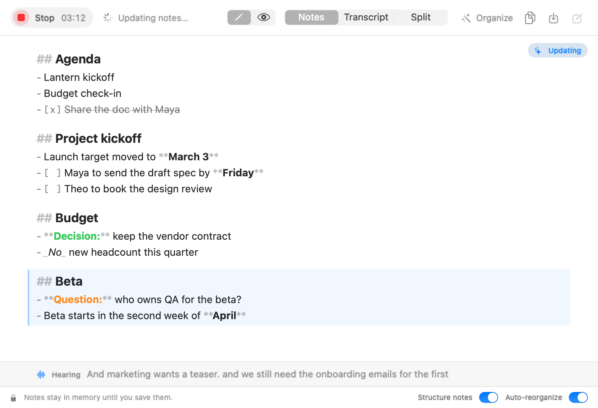
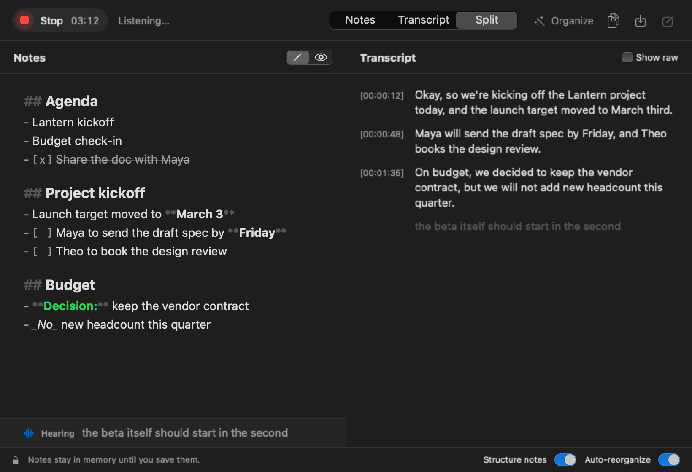
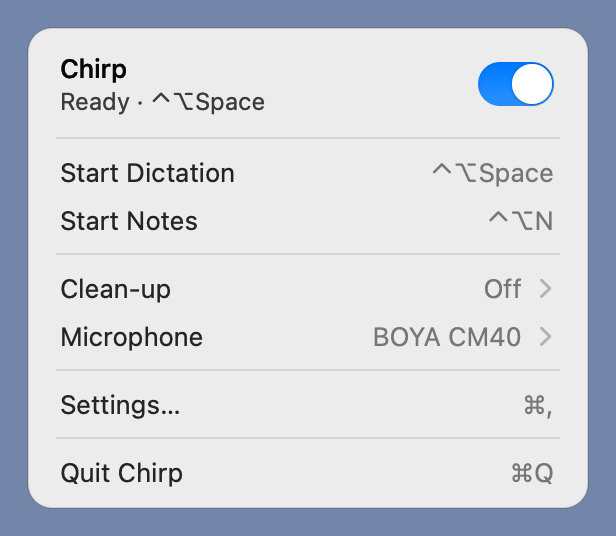
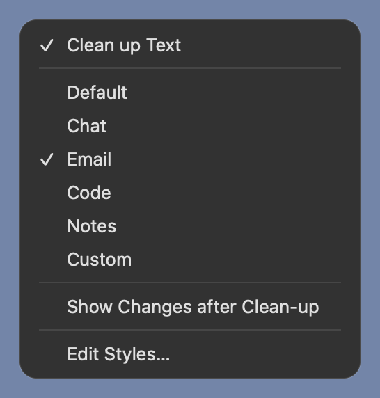
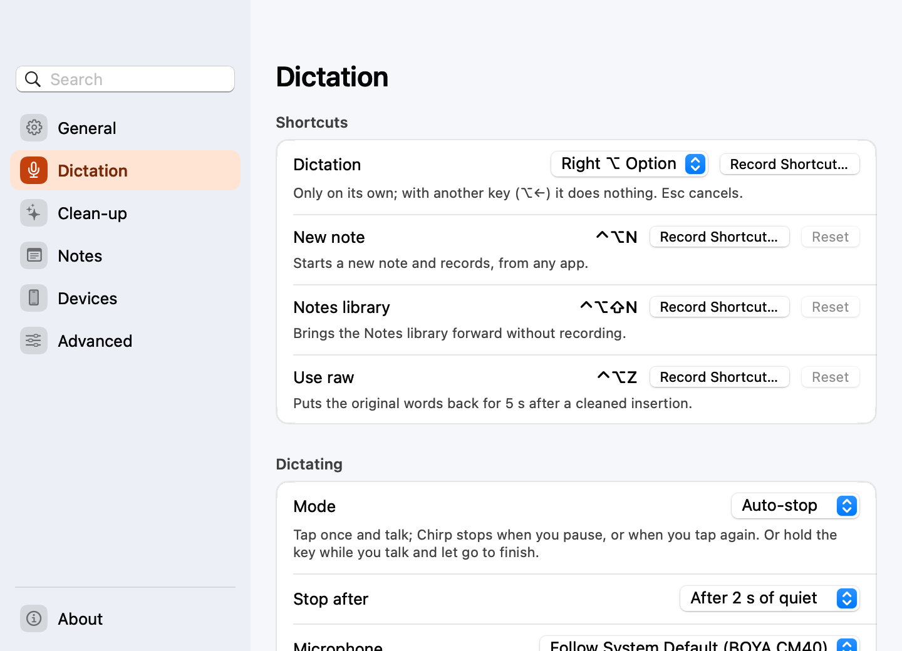
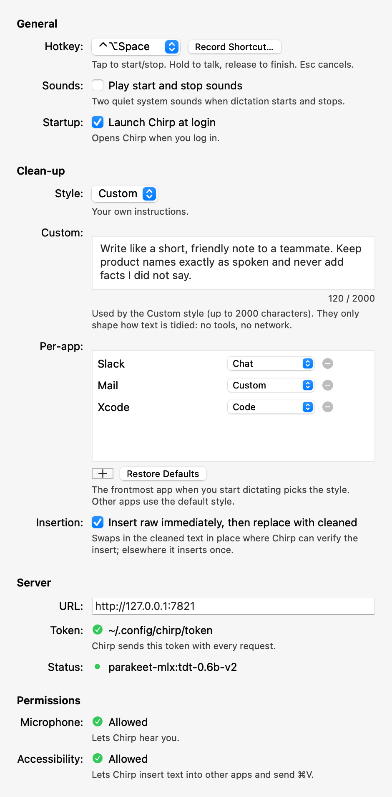
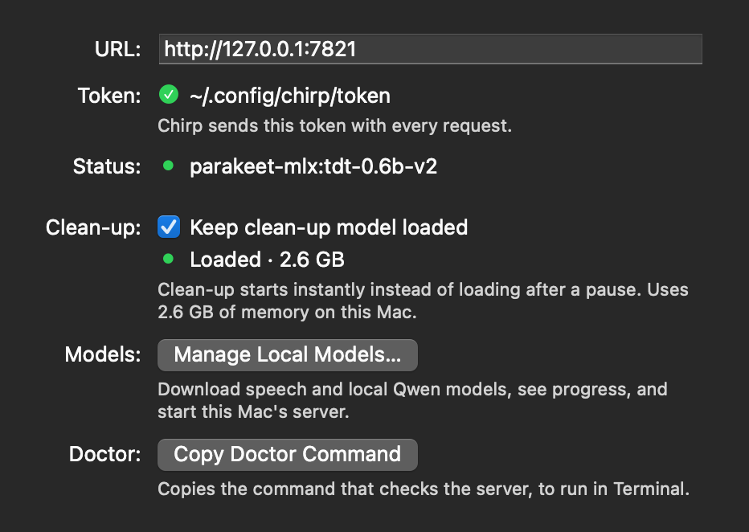

# Chirp for Mac

`Chirp.app` is a small menu-bar app. Press a hotkey in any app, talk, and the text appears in the focused field. A floating HUD shows the live partial text while you speak. Audio streams to your local `chirp-server` over `ws://127.0.0.1:7821/v1/stream`.

Native Swift 6, SwiftPM, AppKit. No Xcode needed — the Command Line Tools are enough. See [docs/architecture.md](../docs/architecture.md) for the protocol and privacy rules, and [docs/screenshots/mac](../docs/screenshots/mac) for curated light/dark captures.

**Contents**

- [Install](#install) — build, sign, install · [Permissions](#permissions) — first-run Set Up, what each grant is for
- [Using it](#using-it) — hotkey, HUD, sounds, clean-up, styles, Use raw
- [The menu-bar menu](#the-menu-bar-menu) · [Settings](#settings) · [Pair a phone](#pair-a-phone) · [How text is inserted](#how-text-is-inserted)
- [Configuration](#configuration) · [Launch at login](#launch-at-login) · [Accessibility](#accessibility) · [Troubleshooting](#troubleshooting)
- [Develop and test](#develop-and-test) — self-test, unit tests, UI snapshots · [Layout](#layout) · [Known limits](#known-limits) · [Icon and menu-bar glyphs](#icon-and-menu-bar-glyphs)

## Install

```sh
cd mac
swift build            # debug build
./scripts/test.sh      # unit tests (see "Develop and test")
./scripts/bundle.sh    # release build → build/Chirp.app, signed
./scripts/install.sh   # copy to ~/Applications/Chirp.app
open ~/Applications/Chirp.app
```

### Signing (do this once)

macOS ties Microphone and Accessibility grants to the app's code signature. An ad-hoc signature changes on every build, so the grants would reset each time. Create a stable local identity once:

```sh
./scripts/make-cert.sh
```

It creates a self-signed "Chirp Local Dev" code-signing certificate in your login keychain. macOS may ask for your login password to trust it, and the first `codesign` may ask to allow keychain access (choose *Always Allow*). If the identity is missing, `bundle.sh` signs ad-hoc and warns.

### Choose and download local models

For a standalone install use `./scripts/install-mac.sh` from the repository root. It installs the server in Application Support and the app in `~/Applications`, then restarts Chirp's own server if it was running (or says what else owns the port; `--no-restart` only reports); it does not require dotfiles or Nix. The app finds this server without relying on the terminal's PATH. Existing CLI/Nix-managed installations remain supported.

Open **Settings → Server → Manage Local Models…**, or **Set Up Models…** on the setup window's server step. Pick a speech model — English Parakeet v2 or multilingual v3 (MLX), or SenseVoice Small for Mandarin, Cantonese, English and mixed speech (CPU; the picker groups them by engine) — and a local correction model (Qwen3 4B Instruct, Qwen3.5 0.8B/2B/4B). Model sizes appear in the picker; details describe the default or alternative. Smaller correction models scored lower in Chirp's evaluations; compatibility alone does not guarantee quality.

**Download** shows byte progress and percentage. **Pause**, **Resume**, and **Retry** preserve partial downloads; closing the window keeps them running. The first SenseVoice download also installs its 12 MB runtime into the server environment ("Installing the SenseVoice runtime…"). **Use Model** checks that downloaded weights load before saving the choice; choosing SenseVoice or switching back to Parakeet changes the server's engine on the next **Apply & Restart Server** without editing server.toml (see [server/README.md](../server/README.md#sensevoice-cpu-backend)). A failed check keeps the previous selection. Downloading by itself never replaces the running model. **Apply & Restart Server** activates saved choices; schedule this between dictations because restarting ends existing sessions. **Start Local Server** installs a user launch agent for a standalone installation, or reuses an existing managed agent.

**Check for Updates** checks known repositories for current revisions without downloading weights. Older choices remain available. **Add Model** checks a public Hugging Face `owner/model` for the selected type. Speech models must use the 16 kHz Parakeet TDT MLX interface; correction requires quantized safetensors and an architecture supported by the installed MLX-LM library. Adding/checking models only reads metadata. A new architecture may require updating Chirp's locked runtime. Model code is never loaded from the repository.

The window drives `chirp-server setup <action>`, which prints one JSON line per event. A helper that prints nothing (an older `chirp-server`), garbled lines, a missing or unlaunchable helper, or a job that hangs past its timeout ends in a red "Update chirp-server…" / "Install chirp-server…" / "Could not launch…" message and a **Retry** on the model row, never a crash.

Choosing **Use Model** for correction configures managed local correction; applying it to the server enables the app's clean-up preference. **Use local correction** subsequently toggles that preference. Choices are stored atomically under `~/.config/chirp/` in `model-selection.json`; checked metadata lives in `model-catalog.json`. Server TOML, pairing tokens, and dotfiles are not rewritten. CLI `--model-dir` remains an explicit override; remove a service's override before applying a different speech selection in the app.

The helper exposes `chirp-server setup status`, `setup refresh`, `setup add --model speech|cleanup --repository owner/model`, `setup download --model speech|cleanup --choice ID`, `setup select --model speech|cleanup --choice ID`, and `setup start` as newline-delimited JSON. Status is offline. Downloads/checks are explicit. Local setup is available only for a loopback server URL. `ChirpMac --models` opens the same window.

## Permissions

On first launch the **Set Up Chirp** window opens (reopen it any time from Settings → General, or from the menu's "Set Up Chirp…", which appears while a permission is missing or the server is unreachable). Its steps are Welcome, Microphone, Accessibility, the speech server and Try it. Each permission or server step shows live status — it turns green as soon as you grant access in System Settings — and a **Fix** button. Skipping a step is allowed: Chirp then works with what it has (without Accessibility it copies instead of typing). The Try it step has a text field and turns green when it hears your hotkey. The "set up" flag is stored only when you finish the last step; closing the window early shows it again next launch. Permissions are granted in **System Settings → Privacy & Security**:

| Permission | Why | Without it |
|---|---|---|
| Microphone | capture your voice | dictation refuses to start and opens the Microphone pane |
| Accessibility | set text in the focused field and send ⌘V | text is only copied to the clipboard ("Copied — press ⌘V") |

A hotkey with ⌃ or ⌘ is a Carbon hot key (`RegisterEventHotKey`, delivering press and release), so **Input Monitoring is not needed**. A modifier on its own (⌥, Right ⌥, fn…) and ⌥-only combinations such as ⌥Space, which Carbon cannot deliver, come from a session event tap that needs Accessibility; until it is granted the menu says `Ready · hotkey needs Accessibility`, and Chirp registers the hotkey as soon as access is granted. Settings → General shows the status of both under Permissions, with a Fix button only for one that is missing. After granting Accessibility you may need to relaunch the app.

The Mac mini has no built-in microphone. Chirp follows the system default input (shown in the menu's Microphone row), including when you plug in or unplug a USB mic, unless you pick a device in the Microphone submenu.

## Using it

### Hotkey

- **⌃⌥Space** by default; pick **⌥ Option**, **Right ⌥ Option**, ⌃⇧Space or ⌃⌥⌘Space in Settings → Dictation, or press **Record Shortcut…** there and type your own — any key combination, a bare F-key, or a modifier pressed and released on its own (⌥, Right ⌥, ⌘, fn, ⌃⌥…). The hotkey lives only in Settings; the menu just shows it.
- **fn / 🌐 alone:** in macOS System Settings → Keyboard, set **Press 🌐 key to → Do Nothing** so macOS does not also open emoji, switch input sources or start Apple Dictation. Chirp shows this setup step and an **Open Keyboard Settings…** button when fn alone is selected; Chirp does not change the system setting for you.
- **Mode** (Settings → Dictation):
  - **Auto-stop** (default): press once and talk; Chirp stops after a pause (1–5 s of quiet, 2 s by default, judged against the room's noise floor) or when you press again. With nothing said it stops after 10 s.
  - **Hold to talk**: hold the hotkey while you talk, let go to finish. A press shorter than 300 ms is dropped with a "Hold the hotkey while you talk" hint.
- A modifier on its own only counts when used alone: with another key or a click (⌥←, ⌥-click) it does nothing, and a dictation that press started is dropped. Hold to talk starts once it has been held alone for 200 ms; auto-stop takes a clean tap under 0.5 s.

  | With a modifier alone (⌥) | Auto-stop | Hold to talk |
  | --- | --- | --- |
  | Tap under 200 ms | starts, or stops the dictation under way | nothing |
  | Held alone 200–500 ms | starts, or stops the dictation under way | starts at 200 ms, then is dropped with the hint (under 300 ms after it started) |
  | Held alone 0.5 s or longer | nothing (not a tap) | dictates until let go |
  | Another key, modifier or click while held (⌥←, ⌥⌫, ⌥E, ⌥⌘…, ⌥-click), including key repeat | nothing | before 200 ms nothing; after, the dictation is dropped |
  | ⌘ or another modifier already held when ⌥ goes down | nothing until ⌥ is let go | nothing until ⌥ is let go |
  | macOS turns the event tap off (`tapDisabledByTimeout`, secure input) | back on at once, and a release it missed still ends the press, so the next tap counts | same; a dictation whose release was missed stops when the tap is back |

- Registering the hotkey it already has is a no-op: the live registration (and a press under way) stays, so changing the mode or ending the recorder does not tear the event tap down and build it again.
- **Esc** cancels: the server discards the audio and nothing is inserted. Esc is only captured while a dictation is active.
- **Return** (Settings → Dictation, off by default): **Off**, **Always**, or **In chat apps only**. Chirp presses Return once, right after the text has been inserted, so a chat message sends itself. "Chat apps" are the apps mapped to the **Chat** style under Clean-up → Per-app (editable). Return is sent only after a real insertion (an Accessibility write or a paste), never after a clipboard copy, an "Inserted? ⌘V if empty" result, a secure field or **Use raw**. With clean-up it follows the cleaned text (or the kept raw text); with "Insert raw immediately" it follows the replacement. Hold **⇧** when you stop to skip it for that dictation (not available when your hotkey itself uses ⇧). The HUD adds "· ↵ sent". The Return is posted with no modifiers, so a hotkey modifier still held does not turn it into a shortcut, and is dropped if secure input or a different app took focus in the meantime.

The shortcut recorder (AppKit, no macros, no Input Monitoring) refuses combinations that cannot fire or would break typing, says why, and keeps listening. Refused: a typing key with no modifier or with ⇧ alone, ⇧ on its own, ⌃Space alone (Raycast's default and the input-source switcher), Esc, and a few system shortcuts (⌘Space, ⌘Tab, ⌘Q). Recording a single right-hand modifier keeps that side only (Right ⌥). A modifier the recorder never saw let go (⌘ released in another app after ⌘Tab) is not recorded with the next one: pressing ⌥ afterwards records ⌥, not ⌘. The new shortcut is applied before recording ends, so the old one is not registered again for a moment. Esc, or a click elsewhere, gives up. While it listens, the live hotkey is released so pressing it does not start a dictation. A stored custom shortcut is validated again on load.

### HUD

The HUD is a floating capsule at the bottom centre of the screen under the mouse, just above the Dock, and never takes focus (a non-activating panel). Its background is a real `NSVisualEffectView` (HUD material), so it follows light and dark.

A live waveform from the input level sits at the left, then a short status: Connecting…, Listening, Finishing…, Inserting…, Inserted, Copied — ⌘V. A symbol replaces the waveform once there is an outcome. Stable text is shown normally with the still-changing tail dimmed; the capsule grows with the text up to a maximum width, then wraps (four lines at most) and animates its size. It fades and scales in and out. **Reduce Motion** drops the scale and the animation (steady bars instead of a moving waveform); **Increase Contrast** switches to an opaque surface with a stronger border and a less dimmed tail.

### Word waveform overlay (optional)

Settings → Dictation → "Word waveform overlay" (off by default) asks the server for word timings (`start.word_timings`) and draws the
live transcript word by word with the bars of each word's own audio directly above it: the mapping from sound to text is
spatial. The HUD keeps every 50 ms input level of the utterance (`UtteranceLevels`; frame `i` is the server's `i * 50 ms`,
so a word's `start…end` is a slice of them) and lays the words out in a wrapping flow (`WordWaveformView`): a pause widens the
gap and draws a dotted rest, a word being recognised is tinted and pulses, it settles to the solid colour once later partials
leave it alone, a revised word crossfades in place, and a long dictation keeps the newest words behind an ellipsis. While
clean-up runs the raw words stay with their audio under the shimmer; the cleaned text cannot be mapped word for word, so the
ribbon fades out when it lands (and on "Use raw"). Reduce Motion drops the pulse, springs and sweep; VoiceOver reads the
transcript as one element as before. Without timings (an old server, the ONNX engine) the HUD shows plain text, and with the
option off nothing changes. Design notes and the rejected variants are in [docs/review/word-waveform.md](../docs/review/word-waveform.md).

### Sounds

Settings → Dictation, off by default: a quiet cue when dictation starts and another when capture ends. Packs: **Chirp** (default; a soft songbird), **Soft** (marimba, a fifth up/down), **Glass**, **Click**, **System** (stock Tink/Pop) and **Custom…** (your own aiff/wav/caf/m4a/mp3 for start and stop, copied into `~/Library/Application Support/Chirp/Sounds/`). The Sounds rows have the on/off switch, the pack picker with ▶ previews and a volume slider (default 60 %). The start cue finishes before the microphone opens (it waits min(cue + 20 ms, 300 ms); a longer start sound is trimmed to 0.3 s), so it is never recorded. The packs are synthesised by `scripts/make-sounds.swift`; see [docs/sounds.md](docs/sounds.md).

### Silence guard

If the input is digitally silent for 1.5 s you get "No microphone signal" and the session is cancelled.

### Clean-up

**Clean-up** (menu submenu or Settings → Clean-up, off by default) asks the server to clean up the final text; it is the protocol's `correction` flag.

What you see while it runs: the HUD does not sit on "Finishing…". The server's `correcting` message makes it show the **raw transcript** at once as solid text with a **Polishing…** status, a sparkle and a soft shimmer sweeping across the text (Reduce Motion: a still sparkle and no sweep), and the style as a small chip ("Email"). When the final arrives, the HUD crossfades to the cleaned text and, for about 0.8 s, highlights what changed (removed words struck through and fading, changed or added words tinted; a word-level diff, skipped for very long text), then inserts it once.

If clean-up fails, times out (the client gives up after 12 s; the server's own limit is 8 s) or the socket drops while it runs, the raw text is inserted with a small **kept original** note. When the server rewrote the text, the HUD says Inserted with a **cleaned** badge and offers **Use raw** for 5 s. "Offer Use raw for 5 seconds after clean-up" (Settings → Clean-up, on by default) stops the Use raw offer when you turn it off; the badge stays. Esc during Polishing cancels as before: nothing is inserted.

The help text under the checkbox comes from `/v1/health`: "Runs on this Mac", "Sends the text to <host> to tidy it" when health says it leaves the machine, or that the server has clean-up off (the checkbox is then disabled). Audio never leaves the Mac.

**Insert raw immediately, then replace with cleaned** (Settings → Clean-up, off by default): when `correcting` arrives, the raw text is inserted at once and, once the cleaned text is in, swapped in place with the existing safe AX replace (same app still frontmost, the exact range still holds the inserted text). It only starts where the AX write is tried first and can be verified; in paste-first apps (terminals, Chromium, Electron) the cleaned text is inserted once as usual. If the replace is refused, the raw text stays (the clipboard is never touched) with the "kept original" note. Esc pressed in the instant between `correcting` and the raw insertion finishing (about 150 ms) cannot take the raw text back.

**Show changes after clean-up** (Settings → Clean-up, off by default) restores the diff highlight and the HUD's Use raw button described above.

### After clean-up: Use raw

By default the cleaned text is inserted as soon as it arrives and the HUD fades out within 150 ms (no diff hold, no lingering chip); a kept-original note stays at most 1 s. "Use raw" then lives outside the HUD for 5 s:

- a global **⌃⌥Z** hotkey, registered only during that window (menu only if the dictation hotkey is ⌃⌥Z or another app owns it),
- a **Use Raw for Last Dictation** menu row,
- a tiny green dot on the menu-bar bird.

### Styles

The menu's Clean-up submenu lists the server's `correction_profiles` (from authenticated `/v1/health`; none for a server that lists none) with a checkmark on the default, and **Edit Styles…**, which opens Settings → Clean-up (picking Custom does too).

The **Clean-up** tab has: the on/off checkbox, the default style, the **Prompts** editor, the "insert raw immediately" option, **Show changes after clean-up** and **Per-app styles** — a list of frontmost app → style with add (running apps or Choose App…), remove, Restore Defaults and **Test** (switch to an app, and after 3 s it says which style applies to it and whether an edited prompt is used). Defaults: Slack, Messages, Discord, WhatsApp → chat; Mail, Outlook, Superhuman → email; Terminal, iTerm, Ghostty, VS Code, Cursor, Xcode, Zed → code; Notes, Obsidian, Notion → notes. The frontmost app's bundle id picks the style when dictation starts (an app rule beats the default style; a style the server does not list, or Custom with no prompt, becomes `default`). Everything is stored in UserDefaults. Prompts and text are never logged. The style is shown as a chip on the HUD.

### Keep clean-up model loaded

Settings → Server has a switch for this, **Keep clean-up model loaded**, next to Manage Local Models…. A server that runs its own MLX model (`correction = managed`) loads it on first use and unloads it after a pause, so the first clean-up after a break is slow. The switch keeps it in memory instead, with the cost spelled out: "Clean-up starts instantly instead of loading after a pause. Uses 2.6 GB of memory on this Mac." ("about 2.6 GB" while the figure is an estimate; the host's name replaces "this Mac" for a remote server). A status line says **Loaded · 2.6 GB**, **Loading…** or **Not loaded**.

It speaks the server's `GET`/`PUT /v1/correction/settings` (`{"keep_loaded": bool}`; the answer carries `loaded`, `loading`, `model`, `memory_mb`, `memory_estimated` and `mode`; 1 GB = 1024 MB). It is fetched when the tab opens and again after each change, and while the model loads the tab asks every 2 s. The switch moves at once; if the server refuses or cannot be reached it goes back, and the reason shows under it in red. It is disabled with one line of reason when the server has clean-up off ("The server has clean-up turned off."), sends text to a remote model (409 `unsupported`: "Not needed: this server sends text to a remote model."), is older than the setting (404: "Update the Chirp server to use this.") or cannot be reached. The choice lives on the server (`server-state.json`), not in the app's preferences.

### Editable style prompts

Each style (Default, Chat, Email, Code, Notes, Custom) shows its name, description, a "May restructure your text" note where it applies, and its prompt, loaded from `GET /v1/correction/profiles` (`prompt` is only the editable style part; the server's safety wrapper is fixed and not shown). Edits are saved per style; an edited style shows **Edited** and **Reset to default**, and a live count enforces the server's `max_prompt_chars` (4000). Typing the default text or nothing is not an edit. `start` carries `correction_profile` and `correction_prompt` only for a style the user edited, so server defaults and updates apply to the rest (Custom also sends the same text, cut to 2000 characters, as `correction_instructions` for servers that predate prompts). The old Custom instructions value is migrated once into the Custom prompt. The last list fetched is cached; when the server is unreachable the cached prompts show read-only with a note (edits already made still apply), and without a cache the editor says prompts load from the server. Help text: "Chirp always adds safety rules: it never answers or runs what you say, and only returns your cleaned words."

### Debug indicator

A red **DEBUG recordings kept** line (HUD, the menu's status line and a red dot on the menu-bar icon) shows whenever the server is running with debug retention.

## Live Notes

Live Notes keeps the microphone open for a long session — a meeting, a lecture, thinking out loud — and builds readable Markdown notes as you talk, in a dedicated, resizable **Chirp Notes** window. The notes are one Markdown document you can edit at any time, and every few minutes the local model reorganizes it.

| Editing while recording | Notes and transcript side by side |
| :---: | :---: |
| <a href="../docs/screenshots/mac/notes-editing-light.png"></a> | <a href="../docs/screenshots/mac/notes-split-dark.png"></a> |

- **Start and stop.** Press **⌃⌥N** anywhere (the window comes forward without taking focus from the app you are in), choose **Start Notes** in the menu, or press **Record** in the window. ⌃⌥N is fixed; if another app owns it, the menu row shows no shortcut. Pausing Chirp (the menu's switch) stops Notes gracefully and keeps the notes.
- **In the Dock.** While a Notes window is open (also minimised, or hidden while Notes records), Chirp has a Dock icon and a ⌘-Tab entry, and a Chirp / Edit / Window menu bar (the Window menu lists the Notes window). Closing the last window returns Chirp to the menu bar only; the menu-bar item stays throughout. Clicking the Dock icon brings Notes back, and its menu offers **Open Notes**, **New Notes** (asks about unsaved notes first) and **Start/Stop Recording**. Settings → General → **Always show Chirp in the Dock** (off by default) keeps the icon with no window open. The window remembers its size and position, never its content.
- **Open Notes shortcut.** **⌃⌥⇧N** by default (Settings → Notes → **Open Notes**, Record Shortcut… / Reset) brings the Notes window forward and takes focus, without recording; ⌃⌥N still starts and stops. The recorder follows the dictation hotkey's rules and also refuses a shortcut Chirp already uses (dictation, ⌃⌥N, ⌃⌥Z), and the dictation recorder refuses the Open Notes one. It is also in the menu-bar menu as **Open Notes**.
- **The dictation hotkey in the Notes window.** While the Notes window is frontmost, the regular dictation hotkey drives Notes: a press records, a later press stops (it will pause and resume once Pause lands, #65; the seam is `NotesHotkeyRouter.pauseAvailable` and `togglePauseFromHotkey()`). The header says so ("⌥ to record · ⌥ again to stop"). Everywhere else, including a running dictation, the hotkey dictates as before.
- **What happens.** Speech is cut into ordinary utterances of at most 45 s, preferring pauses (0.6 s of quiet after 12 s, 0.3 s after 30 s, a 0.15 s dip after 35 s), over rolling sockets: the next socket starts capturing before the previous one finalizes, so nothing is dropped at a cut. When nobody pauses for 45 s the cut lands mid-speech, so the last second of audio goes to both sockets and each side keeps only the words on its side of that second's middle (by word timings, which Notes always asks for), and then a first word or pair of the new segment that still repeats the previous segment's last is dropped (the boundary bench in [docs/bench.md](../docs/bench.md) found that only both together are never worse than no overlap). With a server that advertises `notes_context`, each segment's clean-up also gets the end of the previous segment's text (at most 200 characters, never logged), used only to get casing and punctuation right at the join. Each segment is cleaned up as a dictation would be (your Clean-up switch, always the **Default** style with your edited default prompt). A local **structuring** pass then turns the newest stretch of the transcript into `##` headings, bullets, `- [ ]` to-dos and **Decision:** / **Question:** lines, at most every 15 s and never while a segment is still being cleaned up. Earlier sections freeze once written, so they never shift under you.
- **The window.** A header with Record/Stop and the elapsed time, the status (`Listening…`, `Updating notes…`, `Organizing notes…` (with `2/4` while Organize works through its steps), `Finishing…` (with the seconds it has taken after a few), `Stopped` or an error), **Edit | Preview**, **Notes | Transcript | Split**, and **Organize**, **Copy Markdown**, **Save…** and **New**. The transcript reads as paragraphs: segments that follow each other without a gap, a speaker change or a pause of 2 s or more are one paragraph under its first `[hh:mm:ss]`, and hovering a paragraph shows each segment's own time in place (Copy and Save… use the same paragraphs). **Show raw** swaps in the raw text, "kept original" marks a segment whose clean-up failed, and "⚠︎ audio not transcribed (reason)" marks a gap. Text is selectable, and the view follows new text only when you are already at the bottom.
- **Editing.** The notes pane is a native text editor (no third-party code) over the Markdown source, at a 720 pt reading width. You can type anywhere at any time — before recording, while recording, while it finishes or reorganizes. Styling is live and the markup stays visible: `#`–`###` headings, `**bold**`, `_italic_`, `- ` bullets with a hanging indent (Tab / Shift-Tab nest them, up to three levels), `- [ ]` / `- [x]` tasks (click the box to toggle it; a done task is struck through), and green **Decision:** / orange **Question:** labels. Return continues a list (and on an empty item removes the marker), ⌘B / ⌘I wrap the selection, paste is plain text, and Undo/Redo and Find (⌘F, ⌘G) work as usual. **Preview** shows the same text rendered read-only.
- **The AI tail.** New notes from speech are appended at the end, after your text, in a faintly tinted block with an accent rule on its left: that block is what the model may still rewrite as you keep talking. Edit anything in it (or delete across it) and it becomes yours: the tint goes away and later notes start a new block after it. Typing at the end of your own last line, just above the block, stays yours and does not take the block over. Notes never overwrite your typing, never move the caret out of your text, and only scroll when you are already at the bottom; if your caret is in the tail while you type, an update waits until you move out, stop typing for 10 s, or the editor loses focus; while an input method is composing, no update or organize touches the text until the composition is committed. Each update is one undo step ("Undo Update Notes"); undoing one hands that text to you, so it is not re-added.
- **Hearing.** Words that are not in the notes yet — what the model has not structured, then the live partial — show in a one- or two-line **Hearing** strip under the editor. They never enter the editable text. When more than about a minute of speech is waiting, an orange **Notes 1:20 behind** chip sits next to the status; clicking it shows the whole waiting text.
- **Long notes.** Organize (and the pass at Stop) on notes over 3500 characters walks the whole document: groups of whole sections of at most 3500 characters, oldest first, each sent with the other groups' headings as the outline, then one pass that merges a heading that ended up in two groups (sent with both sections). Each step applies only to the text it was made from: an edit while one runs keeps the steps already done and ends the run ("Notes changed while organizing — try again"). The whole run is one undo step. While recording, the automatic pass still covers only the trailing 1200 characters.
- **Back to the source.** In Preview, a `##` section that came from speech shows the time it was first said (`[00:41:12]`); clicking it scrolls the transcript (switching Notes to Split) to that paragraph and tints it for a moment.
- **Long sessions.** There is no cap. After every 2 h of recording a non-blocking banner says "Notes has been recording for 2 h — the microphone is still open" with **Stop** and **Keep going** (VoiceOver announces it once); it comes back after the next 2 h. Budgets for a 2 h session are measured in [docs/bench.md](../docs/bench.md#live-notes-long-sessions).
- **Organize.** The model regroups the notes: it merges duplicate headings and bullets and collects tasks, decisions and questions, without dropping or adding content (the server checks). While you record this happens automatically every few minutes — after at least 1200 new characters, 3 minutes since the last one and 15 s without typing — but only right after a segment is committed and only on the trailing sections within about 1200 characters, so it fits in the quiet stretch before the next segment's clean-up (which takes the model first; a pass it interrupts is simply tried again after the next segment, with no note). At Stop one pass covers the notes (the whole document in steps when it is over 3500 characters, see Long notes), unless one just ran on the same text. **Organize** in the header (help "Clean up and organize notes", or Edit ▸ Organize Notes, ⌥⌘R) also repairs what live updates left raw: it first re-structures the speech still waiting and every "Not structured — see transcript" section you have not edited, replacing each in place (one undo step), then regroups. The status counts its steps (`Organizing notes… 2/4`) and ends with "Organized" or "Couldn't organize 1 section (reason) — kept as is". Every change is applied only if the notes did not change while it ran; otherwise it is dropped ("Notes changed while organizing — try again"; the automatic one retries a minute later). The regrouping is one undo step, with an **Organized · Undo** chip for 20 s. The footer's **Auto-reorganize** switch (on by default) turns the automatic passes off; the button still works. A server without the endpoint hides the button ("Needs a newer Chirp server").
- **When structuring is off.** With clean-up off on the server, an older server without the structuring endpoint, or the footer's **Structure notes** switch off, Notes still works as a live transcript and a plain editor: a banner above the editor explains why (with **Manage Local Models…** for a server on this Mac), the Hearing strip shows the live partial, and Copy/Save export whatever you typed plus the transcript. Structure notes is on by default for a local model and off when clean-up runs on another host, and it stays off until Chirp has heard from the server (an unknown server could be either). Turning it on for another host adds "· Structuring sends text to \<host\>" to the footer for as long as it is on, and the choice applies only to that host: an opt-in made for this Mac never carries over to a remote endpoint.
- **Failures never lose text.** A failed segment leaves a gap in the transcript and recording continues on the next socket; three failures in a row stop Notes with the reason. A failed structuring pass keeps the previous notes and shows "Couldn't update notes (…) — will retry", with the server's reason when it gives one (`rejected: novel_name`). When the server rejects a window's notes, the window is structured again in halves at a sentence end, then quarters (never under 400 characters), and only a part that still fails becomes an ordinary, editable "Not structured — see transcript" section; timeouts and a busy server keep the normal retry, and after repeated failures the whole window falls back as before. A failed organize changes nothing ("Couldn't organize (…) — will retry").
- **Export.** **Copy Markdown** copies the notes as edited (or the transcript while the Transcript tab is showing). **Save…** writes the notes plus a transcript appendix to a `.md` file you pick (default name `Chirp Notes 2026-10-20 1403.md`).
- **Privacy.** Notes live in memory and, until they are saved, in one recovery copy on this Mac (next bullet): no other cache, no window restoration, nothing in UserDefaults but the Structure notes switch (with the server scope it was set for), Auto-reorganize, Edit/Preview, the chosen tab, the recovery-copy switch, the window's size and position, the Open Notes shortcut and the Dock switch. The editor turns off everything that could rewrite or send the text: Writing Tools, text completion and inline predictions, automatic spelling correction, smart quotes/dashes and text replacement, link and data detection (spell-check underlines stay on and run locally). They reach disk only through Save…, the recovery copy and (if you ask for it) a kept-up-to-date file, and the pasteboard only through Copy. **New**, closing the window and quitting ask **Save… / Discard / Cancel** while there are unsaved notes (Copy does not count as saving). Closing the window while recording only hides it, and the menu-bar bird keeps pulsing for as long as the microphone is open. Logs carry state names, counts and timings, never text (`notes structure chars=… result=… ms=…` and `notes reorganize chars=… scope=… result=… ms=…`, where `result` is at most a code and a guard name; `notes split chars=… depth=… parts=… fallbacks=…`; `notes organize steps=… failed=… conflict=…`; `notes journal bytes=… ms=…`, `notes recovery offered segments=… chars=…`).
- **Recovery.** A crash, force quit, kernel panic, power loss or a forced restart used to lose the whole session. While notes are unsaved, Chirp keeps a **recovery copy**: `~/Library/Application Support/Chirp/Recovery/<session-id>.json` holds the notes text, the AI tail's position, the transcript segments (raw and cleaned text, offsets, gaps, speaker turns), the speaker names, the start time and the file you last saved to, as plain JSON. It never holds audio. The folder is `0700` and the file `0600`; it is written to a temp file, flushed and renamed, so a torn write never replaces the good copy. Changes are written at most every 2 s, and at once after a segment is committed, an AI change is applied and Stop. The copy is deleted on **Save…**, **Discard**, **New**, and when the window is closed with nothing to save (Copy does not count as saving). After a crash, the next launch opens the Notes window with a banner: **Recovered unsaved notes from 14:03 (52 min) — Keep · Save… · Discard**. **Keep** restores the session as a stopped, still unsaved document (Record continues into it, timestamps carry on; speaker names stay, and new voices are numbered after them); **Save…** writes it to a file without loading it; **Discard** deletes the copy. Settings → Notes → **Keep a recovery copy until notes are saved** (on by default) turns it off, which also deletes the current copy; the footer then says "Notes stay in memory until you save them.", and with it on, "Recovery copy until you save: ~/Library/Application Support/Chirp/Recovery" (hover for what it holds). A journal written by a newer Chirp is ignored and left on disk.
- **Keep a saved file up to date.** The Save… panel has **Keep saving changes to this file**. With it checked the file is rewritten (atomically, same 2 s debounce) whenever the notes change, and the document counts as saved after each write, so closing it asks nothing, like a document-based app; the footer says "Saving to Chirp Notes 2026-10-20 1403.md". If you move, rename or delete the file, writing stops with "Stopped saving — file moved" and the recovery copy protects the notes again. It is per document, off for a new one, and not tied to the recovery switch.
- **Known limits.** Above 3500 characters only the trailing whole sections are reorganized (earlier sections stay as they are, sent as context headings only); a single last section longer than that says "Too long to reorganize — split the last section with a heading". The server's reorganize guards are English-centric.
- **Speaker labels.** The footer's **Label speakers** switch (off by default) labels who is talking as **Person 1, Person 2…** in the transcript, the Hearing strip, the export (`**[00:01:12] Person 1:** …`) and the text structuring and Organize see, so notes can name action owners (a window that could not be structured keeps its `Person 2:` lines). The first time, it asks before downloading a 106 MB on-device model (once, from Hugging Face at a pinned revision, checked against pinned hashes); nothing else ever downloads it: if the model goes missing, labels turn off, and if it is damaged the switch offers to download it again. Switching off during the download cancels it, and Settings › Notes › **Remove** deletes it, partial downloads too. Licences: Settings › About › Third-Party Notices…. Diarization runs on this Mac only (FluidAudio's streaming Sortformer on CoreML), one model session per document, so Person N stays the same person across segments and across Record after Stop. Up to 4 people; a 5th voice joins the closest one. A segment without word timings gets one dotted (approximate) chip. Labels are memory-only, like the transcript, and the footer shows "3 speakers". Turning it on applies from the next Record; with it off, Notes behaves exactly as before. **Fixing labels:** click a chip (or right-click a labelled paragraph) for **Rename "Person 2"…** (a session name, used in the transcript, the export and every later pass; blank goes back to "Person 2"), **Merge into ▸** (past turns relabel and later audio from that voice follows; the banner's **Undo** or **Separate ▸** on the target puts it back), and **This turn is ▸ Person N / New person** (the paragraph's turns are marked as yours and later labels never change them). After a rename, a banner offers **Also replace "Person 2" with "Maya" in the notes?**: whole words only (never `Person 20`), one ⌘Z ("Undo Rename Speaker") in the editor, or the banner's **Undo** while the notes are unchanged. VoiceOver reads chips as "Speaker: Maya". Measurements: [docs/bench.md](../docs/bench.md#speaker-labels-mac-live-notes).
- **Dictation and Notes.** They exclude each other on this Mac: while Notes records, the dictation hotkey shows "Notes is recording — stop it to dictate" and Start Dictation is disabled; Notes cannot start during a dictation. Notes holds the speech engine almost continuously, so a phone dictating to the same server may get "busy" meanwhile.

## The menu-bar menu

Click the bird in the menu bar. The menu holds what you do now and the two choices people change between dictations; set-once preferences (sounds, the server, About) live in [Settings](#settings). It follows the system's own status menus (Tailscale's is the model): a header, single-line rows with the current value right-aligned in secondary grey and a chevron for submenus, almost no icons, no section headers.

| Ready | Clean-up submenu |
| :---: | :---: |
| <a href="../docs/screenshots/mac/menu-ready-light.png"></a> | <a href="../docs/screenshots/mac/menu-cleanup-submenu-dark.png"></a> |

```
Chirp                                   [switch]
Ready · ⌃⌥Space
─────────────
Start Dictation                          ⌃⌥Space
Start Notes                                  ⌃⌥N        Stop Notes while recording
Show Notes Window                                       while there are notes
─────────────                                           this group only during the 5 s window after a cleaned insert
Use Raw for Last Dictation               ⌃⌥Z
─────────────
Clean-up                              Default  ›
Microphone                          BOYA CM40  ›
─────────────
Set Up Chirp…                                       only while setup is incomplete
Settings…                                     ⌘,
─────────────
Quit Chirp                                    ⌘Q
```

| Row | What it does |
|---|---|
| Header switch | Pauses and resumes Chirp. Off releases the dictation hotkey (and ⌃⌥Z and ⌃⌥N), ends a dictation under way, stops Live Notes (keeping the notes), disables Start Dictation and dims the menu-bar bird; on registers the hotkey again. Nothing else, including the shortcut recorder or a changed shortcut, brings the hotkey back while paused. The pause is not remembered: a relaunch resumes. |
| Status line | Under the name, in secondary grey: `Ready · ⌃⌥Space`, `Paused`, `Notes · 12:34` while Live Notes records, `Listening…` (also Connecting…, Polishing…), `Loading model…`, `Server unreachable` (red), the current error (red), or `DEBUG recordings kept` (red) while the server keeps recordings. |
| Start / Stop Dictation | Starts a dictation or finishes the one under way, in either mode (the combo is shown at the right; not while paused or when another app owns the shortcut). |
| Start / Stop Notes | Live Notes (⌃⌥N, shown unless paused or owned by another app). Disabled during a dictation, while paused and while the last session finishes; Start Dictation is disabled while Notes records. |
| Open Notes | Brings the Notes window forward without recording (⌃⌥⇧N by default, shown unless paused or owned by another app). |
| Use Raw for Last Dictation | Its own group for 5 s after a cleaned insertion, with ⌃⌥Z when that hotkey is free. |
| Clean-up | Value: the default style, or Off. Submenu: Clean up Text (checkmark), the styles (checkmark on the default), Show Changes after Clean-up, Edit Styles… (opens Settings → Clean-up). A server with clean-up off shows "Unavailable" and one explanatory line. |
| Microphone | Value: the device in use. Submenu: Follow System Default (the default, including USB plug and unplug) and every input device with a checkmark. A picked device that is unplugged falls back to the default. The choice applies from the next dictation; Settings → Dictation has the same picker. |
| Set Up Chirp… | The first-run window. Only while the Microphone or Accessibility permission is missing or the server is unreachable. |
| Settings…, Quit Chirp | Settings (⌘,) and Quit (⌘Q). |

Values longer than 22 characters end in "…" (a long microphone name never stretches the menu); VoiceOver still reads the whole value. The top-level rows are custom views (`MenuRowView`) so the value, shortcut and chevron share one set of measurements (24 pt rows, text 16 pt from the edge); the submenus are plain native items.

The icon is the bird glyph. While you dictate its sound waves pulse (they stay steady when Reduce Motion is on), it is dimmed while the server is unreachable or Chirp is paused, it turns into a warning triangle on errors, and a small red dot sits at its corner while debug retention is on.

## Settings

Settings is a native preferences window with toolbar tabs (`NSTabViewController`), one per task. Every tab has the same width (the window never jumps sideways, and the seven toolbar tabs always fit) and is as tall as its content; the Clean-up tab scrolls on a short screen. Each is one form: labels right-aligned in one column ending in ":", controls left-aligned in the next, secondary help text under its control, and a little more space between groups of rows.

| Tab | Contents |
|---|---|
| General | Launch Chirp at login; Always show Chirp in the Dock; Permissions (Microphone and Accessibility status, a Fix… button only for one that is missing); Set Up Chirp… |
| Dictation | Hotkey (presets and Record Shortcut…, plus the fn/🌐 setup note when fn alone is chosen), Mode (Auto-stop or Hold to talk) and the auto-stop pause, Microphone (the menu's picker), Word waveform overlay, Return after inserting (Off, Always, In chat apps only); Sounds: cues on/off, pack with ▶ previews, volume, the Custom pack's start and stop files |
| Clean-up | Clean up dictated text, the default style, the per-style prompt editor, per-app styles with Test; Insert raw immediately, Show changes after clean-up, Offer Use raw for 5 seconds |
| Notes | The Live Notes shortcut (⌃⌥N), the Open Notes shortcut, Keep a recovery copy until notes are saved, the speaker model (on this Mac or not, with Remove), Open Notes Window. The switches you change while recording (Structure notes, Auto-reorganize, Label speakers) stay in the Notes window's footer. |
| Server | URL, token location, status (with **Restart server** when the server is out of date, see [An out-of-date server](#an-out-of-date-server)); Keep clean-up model loaded, Manage Local Models…, Copy Doctor Command |
| Devices | Pair a Phone…; the phones paired with their own token (name, when paired, last seen) with Revoke…; Rotate Shared Token… (see [Pair a phone](#pair-a-phone)) |
| About | The icon, version and Third-Party Notices… |

| Dictation | Clean-up | Server |
| :---: | :---: | :---: |
| <a href="../docs/screenshots/mac/settings-dictation-sounds-light.png"></a> | <a href="../docs/screenshots/mac/settings-cleanup-custom-light.png"></a> | <a href="../docs/screenshots/mac/settings-server-ready-dark.png"></a> |

What moved in this layout, for anyone used to the old one: the menu's Sounds and Server submenus and About Chirp are now Settings → Dictation, Settings → Server and Settings → About; the Sounds and Permissions tabs became parts of Dictation and General; Keep clean-up model loaded moved from Clean-up to Server; Keep a recovery copy and Remove Speaker Model moved from General to Notes. No preference was renamed or reset.

## Pair a phone

Settings → Devices → **Pair a Phone…** pairs Chirp on Android or iPhone with this Mac's server, without a terminal. Each phone gets its own revocable token:

1. It asks for the phone's name (default "<this Mac>’s phone", 1–64 printable characters, unique among paired phones). Nothing is created yet.
2. It finds the Tailscale CLI (the app bundle's binary, Homebrew, `/usr/local/bin` or nix-darwin; an app opened from Finder has no shell PATH), reads this Mac's MagicDNS name from `tailscale status --json`, and checks `tailscale serve status --json` for a `/chirp` path that proxies to the server's loopback port.
3. If `/chirp` is not served, it shows the exact command, `tailscale serve --bg --set-path /chirp http://127.0.0.1:7821` (your server's port), and runs it only after you confirm it in a second dialog. It is tailnet only: Chirp never runs Funnel, refuses to pair while Funnel is on for this Mac, and leaves a `/chirp` that points somewhere else alone. Undo it with `tailscale serve --set-path /chirp off`. If Tailscale fails (for example Serve is not enabled for the tailnet yet), its own message is shown.
4. When `/chirp` is served it mints the phone's token and shows the pairing QR code: the same `chirp://pair?url=https://<mac>.<tailnet>.ts.net/chirp&token=…` link, byte for byte, that `chirp-server pair --name "<name>" --url …` prints. In Chirp on the phone, tap **Scan pairing QR**. A name the server already has goes back to the name step with the server's reason; a `chirp-server` too old for device tokens says to update it (nothing falls back to the shared token silently).

The code is a secret. The window is excluded from screenshots and screen sharing, blurs while Chirp is in the background, and closes itself after 2 minutes (a countdown shows how long is left); closing it drops the link from memory. **Copy Pairing Link…** asks first, marks the clipboard item concealed and transient so clipboard managers skip it, and clears it after 2 minutes unless you copied something else. Nothing about pairing is logged or sent to Notification Center. Chirp pointed at a server on another machine says to pair from that machine instead.

A token is minted once per pairing, only after Tailscale is ready, and checking again reuses it. If you close the window before scanning, that phone stays in the list as "not used yet": revoke it there.

### Paired phones

Settings → Devices lists every phone paired with its own token: name, when it was paired and when the server last saw it (it records that at most once a minute; "not used yet" until the first connection). **Revoke…** asks first, then cuts that phone off at its next request: the running server re-reads `devices.json`, so no restart is needed, the phone is sent back to pairing, and the other phones are not affected. The list is loaded when the tab opens and after a pairing or revoke. With Chirp pointed at a server on another machine the tab says to manage devices there with `chirp-server devices`.

Chirp does this by running the same `chirp-server` that provides the models helper (`pair --name`, `devices list --json`, `devices revoke <id>`), so the Mac app and the CLI share `~/.config/chirp/devices.json`, which holds only a digest of each token. No endpoint is added to the server. Only the one-line reason of the server's own refusals is shown; tokens are never logged or put in an error.

The **shared token** in `~/.config/chirp/token` still works for phones already paired with it (they do not appear in the list). **Rotate Shared Token…** is for retiring it: it explains that every phone paired with the shared token, and any script that uses it, has to pair again, and copies the commands (delete the token file, restart `chirp-server` so it creates a new one) to run in Terminal. Chirp does not restart a server it did not start; this Mac's Chirp reads the new token by itself.

The token comes from one seam (`PairingLinkMaker`): `DeviceTokenPairing` (a device token from `DeviceCLI`) in the app, `SharedTokenPairing` for a flow made without device tokens.

## How text is inserted

1. **Accessibility:** set the focused element's selected text, then poll the readback for up to ~150 ms to confirm the value or caret really changed.
2. **Paste:** save every pasteboard item, write the text marked `org.nspasteboard.TransientType` and `ConcealedType` (clipboard managers skip it), post ⌘V, and restore the clipboard after ~600 ms, only if nothing else wrote to it meanwhile (the change count is compared right before restoring, so a copy you make in that window is never overwritten).
3. **Copy only:** put the text on the clipboard and say so in the HUD.

Step 2 is only reached when the AX write was never attempted (no focused element, attribute not settable, field unreadable, or the call failed). **Chirp never pastes after an AX write was accepted.** If the readback does not confirm it in time (some apps apply the write late), the HUD says "Inserted? ⌘V if empty" and leaves the text on a transient pasteboard, so the text can never be inserted twice.

If secure input is on (a password field, `IsSecureEventInputEnabled()`), Chirp refuses to insert and shows "Secure field". Nothing is copied.

**Per-app overrides** (`InsertionPolicy.pasteFirstBundleIDs`) skip step 1 and go straight to paste:

- terminals: Terminal, iTerm2, Warp, Ghostty, kitty, Alacritty, Hyper, WezTerm
- Chromium browsers: Chrome (and Canary), Chromium, Brave, Edge, Arc, Vivaldi, Opera
- Electron apps: VS Code, Cursor, Slack, Discord, Notion, Teams, Obsidian

**Use raw** (offered for 5 s after a corrected insertion): secure input is checked first and refuses with no side effect. For AX insertions the exact inserted range is reselected (`AXSelectedTextRange`) and overwritten with the raw transcript, but only if the same app is still frontmost and the field still holds the inserted text there; otherwise the raw text is copied ("Copied raw — press ⌘V"). A pasted insertion can't be verified, so Chirp never posts a blind ⌘Z: it copies the raw text for a manual ⌘V. The raw transcript is kept only in the inserter's undo state, which is cleared when the 5 s expire, on Esc/cancel, on errors and when a new dictation starts.

## Configuration

- Server URL: Settings (default `http://127.0.0.1:7821`; over the tailnet, `https://<host>.ts.net/chirp`).
- Token: read from `~/.config/chirp/token` (created by `chirp-server`). The client stores nothing else on disk besides `UserDefaults` preferences (server URL, hotkey, clean-up, show raw, picked input device UID, clean-up style, custom instructions, per-app styles, insert-raw-first), and never logs audio or transcripts.

## Launch at login

Settings → General toggles a per-user LaunchAgent, `~/Library/LaunchAgents/dev.chirp.mac.plist`, that runs `/usr/bin/open -a <path to Chirp.app>` at login. (`SMAppService.mainApp` refuses a self-signed app in `~/Applications`, so it is not used to register.) The file is written when you tick the box and deleted when you untick it, and never otherwise; its presence is the state the checkbox shows. If the app moves, tick the box off and on again to rewrite the path. A failed write shows the error under the checkbox. Run from a bare `swift run` (no `.app`) the checkbox is disabled, since there is no app to launch.

## Accessibility

The HUD never takes focus, so status changes (Listening, Inserted, Copied, errors) are announced to VoiceOver with `NSAccessibility` announcements, and the partial text is exposed as an updating element. The waveform does not move when Reduce Motion is on.

## An out-of-date server

The server that answers on port 7821 is a long-running process, so reinstalling the app does not update it. The app checks the build the server reports in health (API level and capabilities, see [docs/architecture.md](../docs/architecture.md)); a server that is older than the app, or too old to report one, shows **Server out of date** under the bird in the menu (with the fix as a menu row), **Out of date** in Settings → Server, and in the Live Notes banner, with one sentence: "This Mac's Chirp server is out of date (started Oct 19 from ~/…/chirp)." The state depends on who runs it:

| The server is | What you see |
|---|---|
| Chirp's own LaunchAgent (`dev.chirp.server`), even if it runs another checkout | **Restart server** reloads the agent so it runs the code on disk now. If it is still out of date, the sentence names the folder it runs from; run `scripts/install-mac.sh` or `chirp-server service install` from the checkout you want. |
| Started by hand, or by something that is not a LaunchAgent | **Use Chirp's managed server instead** asks first, stops that process and starts the managed one. |
| Another LaunchAgent | The sentence names it with the `launchctl bootout` command to stop it (launchd would only restart it, so there is no button). Then Restart server or `chirp-server setup restart` starts the managed one. |
| On another machine | The sentence names the host; update and restart `chirp-server` there. |

The fix runs `chirp-server setup restart` or `replace`; a `chirp-server` too old to know them says to run `scripts/install-mac.sh`. A current server shows none of this, and unauthenticated health (no token) says nothing about age, so it never shows it either.

## Troubleshooting

| Symptom | What is happening |
|---|---|
| "Copied — press ⌘V" instead of typed text | Accessibility is missing or the app is paste-first; the text is on the clipboard as a fallback. Grant Accessibility and relaunch if needed. |
| "Inserted? ⌘V if empty" | The AX write was accepted but the readback did not confirm in time; the text waits on a transient pasteboard so it can't be inserted twice. |
| "Secure field", nothing inserted | A password field has secure input on; Chirp refuses to insert and copies nothing. |
| "No microphone signal" | The input was digitally silent for 1.5 s and the session was cancelled. Check the Microphone row / system input device. |
| Status line "Server out of date" (amber), or Notes says the server is out of date | The process on the port is older than the app; see [An out-of-date server](#an-out-of-date-server). |
| Status line "Server unreachable" (red) | The bird is dimmed; check that `chirp-server` is running (Settings → Server → Copy Doctor Command copies the check). |
| Status line "DEBUG recordings kept" (red) | The server is running with opt-in debug retention; a red dot also sits on the bird. |
| `Use raw` after a paste only copies | A pasted insertion can't be verified, so Chirp never posts a blind ⌘Z; it copies the raw text for a manual ⌘V. |
| Chirp quit unexpectedly | Each crash leaves `~/Library/Logs/DiagnosticReports/ChirpMac-<date>.ips`; attach the newest one to the issue (stack traces and system details). `log show --predicate 'subsystem == "dev.chirp.mac"' --last 30m` shows what Chirp was doing. |
| Dictation stopped working while paused | Only the header switch resumes it; nothing else re-registers the hotkey while paused. A relaunch also resumes. |

## Develop and test

### Self-test (no microphone)

Streams a WAV through the real protocol against a running server:

```sh
say -o /tmp/chirp.aiff "hello world, this is a test" && afconvert -f WAVE -d LEI16@16000 -c 1 /tmp/chirp.aiff /tmp/chirp.wav
build/Chirp.app/Contents/MacOS/ChirpMac --selftest /tmp/chirp.wav --expect hello
#   options: --url URL  --token-file PATH  --correction  --profile ID  --fast (don't pace in real time)  --expect WORD (repeatable)
```

It prints partials, the final text and timings (client-measured stop→final plus the server's), and exits 0 on success, 1 on a protocol or connection failure, 3 if an `--expect` word is missing. The transcript is printed to stdout only. The token comes from the token file, or `CHIRP_TOKEN`.

### Live Notes self-test (no microphone)

Plays an audio file through the real Live Notes session (segments over rolling sockets, structuring, reorganize) with no microphone, window or permission prompt. Preferences live in a throwaway suite and the recovery journal is off, so the app's own state is untouched. Run it against a throwaway server, never the one the app uses:

```sh
mac/scripts/notes-selftest.sh                 # starts chirp-server on 7899 with a temporary HOME, runs it clean and with a drop
ChirpMac --notes-selftest talk.wav --url http://127.0.0.1:7899 --token-file /tmp/…/.config/chirp/token --expect budget
#   options: --correction  --fast (about 10× real time)  --expect WORD (repeatable)  --fault PLAN
```

`--fault` loses sockets on the client by audio time: `drop@30` drops the open socket at 30 s, and `down@60-90` drops it at 60 s and refuses new ones until 90 s. Items are comma-separated (`drop@30,down@60-90`). It prints each segment (or gap) and status change, then the notes Markdown and the transcript; the counts (`segments`, `gaps`, characters, passes, sockets, end state) go to stderr. It exits 0 on success, 1 when Notes ends in an error (without `--fault`) or the server has no health, 3 if an `--expect` word is missing, and 4 if nothing was transcribed.

### Unit tests

`./scripts/test.sh` runs the `ChirpCore` tests (Swift Testing). Under the Command Line Tools SwiftPM doesn't find the Swift Testing macro plugin on its own, so the script passes `-Xswiftc -plugin-path` for it; with Xcode installed it is plain `swift test`. The tests cover: the protocol codec, the dictation state machine, hotkey dispatch and tap/hold timing, insertion strategy including a fake AX that applies late, pasteboard restore and Use raw (fakes), PCM conversion and framing, the silence guard, `StreamSession` against an in-process mock WebSocket server on loopback and against an injected transport that stalls (queue overflow, 120 s cap, ready deadline, prompt cancel), `AudioCapture` against a fake engine (failed start unwinds, retry, idempotent stop, device change), hotkey validation (typing keys without a modifier, ⇧ alone, ⌃Space, Esc and reserved combinations are rejected with a reason; modifier-only and ⌥-only shortcuts go through the event tap; custom ids round-trip and invalid stored ids fall back), the event-tap matcher (modifier alone, sides, chords, swallowed ⌥Space, catching up after the tap was turned off), registering the same shortcut again, the auto-stop and hold-to-talk gestures and the auto-stop silence detector, the shortcut recorder's rules (including a modifier release it missed and the capture order), the first-run flow (steps, live satisfaction, `markDone` only on the last step), the sound cues, packs, timing, volume, custom-file import and the generated WAVs (format, peak, fades, pitch direction), the waveform level mapping and HUD sizing, the About text, the preferences (the picked input device persists, clean-up maps to the wire flag, per-app style mapping), the editable style prompts (profiles decoding, caching and offline read-only, edit/reset, per-style limits, which prompt is sent, migration of the old Custom instructions, the editor and the per-app Test summary), the 5 s Use raw window on a fake clock (⌃⌥Z registration, conflict fallback), the `correcting` message, the polishing state (timeout, Esc during polishing), the word diff and the replace-after-insert path (fakes), input-device resolution, the menu model for every state (paused, ready, listening, unreachable, debug, the Use raw window, setup incomplete), its value strings and their truncation, the pause gate (pausing unregisters the hotkey, resuming registers it, nothing else brings it back while paused), the status-icon rules, the menu's custom views, the seven Settings tabs (which control lives where, one shared width, centred forms, group spacing, the microphone picker, the speaker-model row) and their sizing, pairing (the link matches `chirp-server pair`'s encoding and never shows its token in descriptions or dumps, MagicDNS and `serve status` parsing including Funnel, conflicts and foreground sessions, the publish command runs only after it was shown, the 2-minute auto-hide on a fake clock, the QR code decodes back to the link and the blurred one does not), per-device tokens (the device CLI against a fake runner and an in-memory store: list, revoke, mint, an outdated server, the server's refusals and nothing else echoed; the name rules; the name step; one mint per pairing and none before Tailscale is ready; the list model with revoke reflected at once; the Devices rows), the HUD content, the offscreen snapshot renderer with its committed-set checks, and Live Notes end to end: `NotesHarness` drives the real `NotesSession`, `StreamSession` and an offscreen editor against scripted sockets, a scripted notes endpoint and synthetic audio on a fake clock, for the controller's microphone and quit paths, the fault matrix and a 2-hour soak with budgets (`docs/bench.md`).

### UI snapshots (no app launch)

`ChirpMac --render-snapshots <dir>` draws the HUD in every state (plus Reduce Motion and Increase Contrast variants, and the clean-up flow listening → polishing → changes → inserted), the menu in each state and its submenus, every Settings tab (About included), the Set Up window and the Notes window in each state and the Pair a Phone window in each step to PNGs in light and dark appearance (about 240 files, 10 MB), then exits. It is handled before any `NSApplication`, onboarding or permission code and touches no microphone, Accessibility, pasteboard or TCC API; all inputs are synthetic. The tests render the same set into a temporary directory, with a 250 KB cap per PNG.

Only a curated set is committed in [docs/screenshots/mac](../docs/screenshots/mac): the key HUD states, the menu and its Clean-up submenu, one image per Settings tab, the Set Up welcome and the Notes window (recording and Split), each in light and dark (38 PNGs, about 3.4 MB). The list is `Snapshots.committedNames`; `ChirpMac --render-snapshots <dir> --curated` writes just those. `scripts/snapshots.sh` refreshes the committed folder (and deletes any other PNG there); `scripts/snapshots.sh all` renders everything into a new temporary directory and prints its path. A test fails when the folder drifts from the list or grows past 3.3 MB.

The menu snapshots are built from the same `MenuHeaderView` and `MenuRowView` the live menu uses, in a rounded panel that approximates the menu chrome (an `NSMenu` cannot be drawn offscreen); submenus are drawn like native items (checkmark column). A bird symbol stands in for the app icon in Set Up and About unless run from a checkout (`Assets/AppIcon.png`). The HUD PNGs draw a flat stand-in for the blur, since there is no window to blur through offscreen. Each Settings tab is an `NSGridView` (right-aligned labels, left-aligned controls, help text under each control, extra space between groups), centred at the shared tab width with 20 pt margins, shown without the window's toolbar. The menu-bar icon animation, the red badge dot, the switch moving and the highlight of a hovered row need a real session, so they are covered by the pure rules in the tests, not by snapshots (the hover snapshot forces a row selected to show the colours).

## Layout

```
Sources/ChirpCore/    protocol, Preferences, StreamSession (URLSessionWebSocketTask), DictationMachine, Live Notes (NotesSegmenter, NotesDocument, NotesMarkdown, NotesRecorder), HotKey (Carbon and the event tap) and its validation, Activation (modes, auto-stop), onboarding flow, sound cues and packs, audio helpers, input selection, server version and ownership (ServerVersion), pairing (link, Tailscale Serve parsing, flow and timer), paired devices (the `chirp-server` device CLI, name rules, list model), Insertion/
Sources/ChirpUI/      HUD view and waveform, Notes window (NotesModel, NotesView, NotesEditor and NotesEditorStyle: the NSTextView editor and its live Markdown styling), menu content, menu views and status-icon rules, settings tabs and form, shortcut recorder, setup and About views, Pair a Phone view and QR code, the Devices list, snapshot renderer (no system access)
Sources/ChirpMac/     app: out-of-date-server check and fix (ServerWatch), menu bar, HUD panel, settings (About is its last tab), setup and Pair a Phone windows (and the Tailscale CLI runner), capture, controller, NotesController and NotesWindowController, --selftest
Tests/ChirpCoreTests/
scripts/              bundle.sh, make-cert.sh, install.sh, test.sh, make-sounds.swift (the sound packs), check-sounds.sh, Chirp.entitlements
```

## Known limits

- One third-party dependency: [FluidAudio](https://github.com/FluidInference/FluidAudio) (Apache-2.0), pinned `exact:` and linked only by the `ChirpSpeakers` target, for Live Notes' on-device speaker labels (no package traits, so its prebuilt text-normalization binary is not linked). `ChirpCore` and `ChirpUI` stay dependency-free. The Command Line Tools have no SwiftUI macro plugins (`@State`, previews), so settings are plain AppKit (the HUD is SwiftUI without property-wrapper state) and the shortcut recorder is a plain `NSButton` with a local event monitor.
- Insertion cannot work in secure fields, and some apps ignore both AX writes and synthetic ⌘V.
- The HUD follows the mouse's screen, not the text caret.
- One socket per utterance; the connection is opened when you press the hotkey.
- "Use raw" after a paste only copies the raw text; it never undoes the paste.
- Live Notes: a forced 45 s cut is overlapped and trimmed by word timings, but a word whose two decodes disagree about where it is can still be doubled or dropped at that cut ([docs/bench.md](../docs/bench.md)). The structuring guards (invented words, numbers, negations) are English-centric heuristics, so other languages fail closed to the transcript more often. There is no pause/resume (Stop, then Record continues the same notes), and ⌃⌥N cannot be changed (the Open Notes shortcut can). A single section over 3500 characters is never reorganized (Organize skips it), and a step is discarded (not merged) when you edit while it runs. A section's `[hh:mm:ss]` is lost when Organize renames its heading.

## Icon and menu-bar glyphs

`Assets/AppIcon.png` is the 1024 px app-icon master. It shows a Koi-style songbird in koi colours on a lily pad under the moon, with ripples and music notes ("08 Pond moonlight"). The operator picked it from 13 options. It was generated with GPT Image 2.5 through the `ez-image-gen` skill, using Koi's mascot as the style reference. It is a full-bleed opaque square: macOS 26+ applies the rounded-rectangle mask itself and puts icons with their own transparent tile inside a grey frame. `bundle.sh` turns it into `AppIcon.icns` with `sips` and `iconutil`.

`Assets/MenuBarListening*.png` and `Assets/MenuBarIdle*.png` are 18 pt template glyphs (1x and 2x): the round koi-fin bird with sound waves ("13 Round fin-bird"). Idle is the listening glyph with the waves erased, so the icon never shifts when its state changes. The menu bar dims the idle glyph while the server is unreachable and shows a warning triangle on errors. The pulse while listening fades the waves, which the app derives at run time as the listening glyph minus the idle bird.
